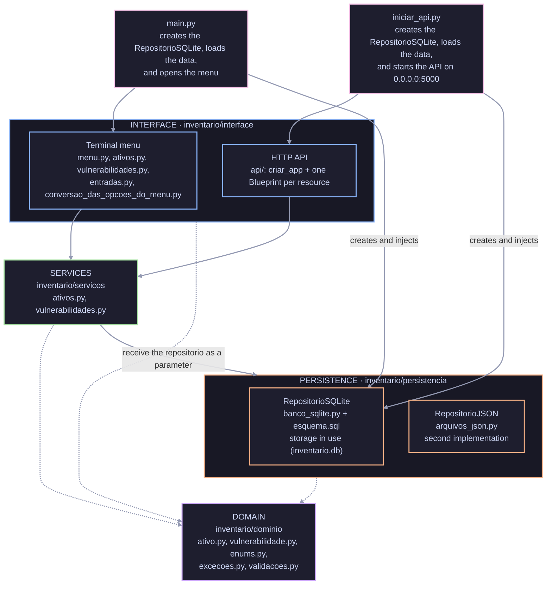

# IT Asset & Vulnerability Manager

*[Ler em português](./docs/README.pt-br.md)*

A Python application for registering and managing IT assets and their associated security vulnerabilities, with risk analysis based on linear algebra. It can be used through a command-line (CLI) menu, through an HTTP API that runs in a Docker container, or through a web frontend served by that same API. Built as a study project for a Cybersecurity course at UFU, applying clean code practices: expressive naming, single-responsibility functions, layered architecture, object-oriented programming, and error handling that doesn't leak internal details.

## ✨ Features

### Assets
Each asset type is a **subclass** of `Ativo`, with its own specific attributes:

- **Notebook**: operating system, screen size
- **Server**: RAM amount, storage
- **Router**: number of ports, speed
- **Printer**: color (color / black and white), technology (inkjet / laser)

**Available operations:**
- **Registration**: ID, name, type, department (IT / Finance / Marketing / HR / Legal), owner, status (Active / Inactive / Under maintenance), and type-specific attributes, all with input validation.
- **Listing**: view all assets, filter by **type** or by **status**, or show a single asset by **ID** or by **name/hostname** (partial, case-insensitive).
- **Editing**: update owner, status, department, and type-specific attributes, or **change the asset type** while keeping its linked vulnerabilities.
- **Deletion**: remove an asset by ID, with confirmation before deletion.

### Vulnerabilities
Vulnerabilities live in a single **catalog**, independent of the assets. Each asset stores only a **reference** (the vulnerability ID) and the **treatment status** of that vulnerability on that specific asset. This way, the same vulnerability can be open on one asset and fixed on another, and correcting its data in the catalog updates every linked asset at once.

- **Catalog registration**: name and **CVSS score** (0.1 to 10.0, accepting a comma as the decimal separator and rounded to one decimal place), with an automatically generated ID
- **Severity level**: calculated from the CVSS score using the official ranges (Low / Medium / High / Critical), so it never contradicts the score
- **Linking**: link a catalog vulnerability to an asset, with a treatment status (Open / In treatment / Fixed / Accepted)
- **Listing**: view the whole catalog, or the vulnerabilities of a specific asset with their status on it
- **Status update**: change the treatment status of a vulnerability on a specific asset
- **Unlinking**: remove a vulnerability from an asset, keeping it in the catalog
- **Catalog editing**: fix the name or the CVSS score
- **Catalog deletion**: remove a vulnerability from the catalog and from every linked asset, with confirmation

> **In development:** integration with CVE for identifying known vulnerabilities.

### Risk Analysis
Model based on linear algebra that estimates the risk of each asset from its vulnerabilities and from the dependencies between assets. The calculation lives in `inventario/servicos/riscos.py` and uses `numpy`:

- **Matrix `M`** (assets × vulnerabilities): `1` when the vulnerability is linked to the asset with status Open, In treatment, or Accepted; `0` when it is Fixed or not linked
- **Vector `v`**: the CVSS score of each catalog vulnerability
- **Exposure factor `f`**: a weight per asset. Each subclass has its default in `FATOR_EXPOSICAO_PADRAO` (Notebook 1.2, Server 1.3, Router 1.5, Printer 0.9), and the value can be changed per asset at registration and editing, greater than 0 and at most 2
- **Own risk**: `b = f × (M @ v)`
- **Matrix `A`** (assets × assets): `A[i][j]` is the fraction of risk that asset `i` inherits from asset `j`, taken from the dependencies
- **Effective risk**: the solution of `(I − A)x = b` with `np.linalg.solve`. Before solving, the program checks that the determinant of `I − A` is not almost zero (tolerance `1e-10`); if it is, it shows an error asking to review the dependency fractions
- **Inherited risk**: effective risk − own risk
- **Ranking**: assets sorted by effective risk, from highest to lowest (`AnaliseDeRisco.ranking()`)

Option 7 of the main menu shows one line per asset, in ranking order, with the exposure factor and the own, inherited, and effective risks, followed by a legend. The same ranking is available through the API at `GET /riscos`.

### HTTP API
A Flask API exposes every operation of the menu as an HTTP service on port 5000, so other programs (such as a web frontend) can use the system. Requests and responses use JSON, with the same keys that `para_dicionario()` produces; vulnerability responses also carry the severity level (`"nivel": "CRITICO"`).

| Method | Route                                     | What it does                                                                                                   |
| ------ | ----------------------------------------- | -------------------------------------------------------------------------------------------------------------- |
| GET    | `/saude`                                  | Health check: returns `{"status": "ok"}`                                                                       |
| GET    | `/opcoes`                                 | Lists for the forms: types (with the default exposure factor), departments, statuses, colors, and technologies |
| GET    | `/ativos`                                 | Lists the assets, with optional filters and sorting                                                            |
| POST   | `/ativos`                                 | Registers an asset of any type (201)                                                                           |
| GET    | `/ativos/<id>`                            | Returns one asset                                                                                              |
| PUT    | `/ativos/<id>`                            | Edits an asset, including changing its type                                                                    |
| DELETE | `/ativos/<id>`                            | Deletes an asset (204)                                                                                         |
| GET    | `/ativos/<id>/vulnerabilidades`           | Vulnerabilities of an asset, with name, CVSS, level, and treatment status                                      |
| POST   | `/ativos/<id>/vulnerabilidades`           | Links a catalog vulnerability to an asset (201)                                                                |
| PUT    | `/ativos/<id>/vulnerabilidades/<id_vuln>` | Updates the treatment status of a link                                                                         |
| DELETE | `/ativos/<id>/vulnerabilidades/<id_vuln>` | Unlinks a vulnerability from an asset (204)                                                                    |
| GET    | `/ativos/<id>/dependencias`               | Dependencies of an asset, with the name of the asset it depends on                                             |
| POST   | `/ativos/<id>/dependencias`               | Adds a dependency (201)                                                                                        |
| PUT    | `/ativos/<id>/dependencias/<id_dep>`      | Changes the asset it depends on and/or the fraction                                                            |
| DELETE | `/ativos/<id>/dependencias/<id_dep>`      | Removes a dependency (204)                                                                                     |
| GET    | `/vulnerabilidades`                       | Lists the vulnerability catalog                                                                                |
| POST   | `/vulnerabilidades`                       | Registers a vulnerability; the ID is generated by the server (201)                                             |
| GET    | `/vulnerabilidades/<id>`                  | Returns one vulnerability                                                                                      |
| PUT    | `/vulnerabilidades/<id>`                  | Edits the name and/or the CVSS                                                                                 |
| DELETE | `/vulnerabilidades/<id>`                  | Deletes from the catalog and unlinks from every asset (204)                                                    |
| GET    | `/riscos`                                 | Risk ranking with own, inherited, and effective risk                                                           |

`GET /ativos` accepts filters and sorting in the query string, and they can be combined: `tipo` (e.g., `Notebook`), `status` (e.g., `1`), `nome` (part of the name, case-insensitive), and `ordenar` (`id`, `nome`, or `vulnerabilidades`). Example: `/ativos?tipo=Notebook&status=1&ordenar=nome`.

**Editing and deleting:** `PUT /ativos/<id>` receives the whole asset; the ID in the URL wins, and if `fator_exposicao` is missing and the type did not change, the current factor is kept. In the `PUT` of vulnerabilities and dependencies, a field that is missing or `null` keeps its current value. Deleting an asset also removes the dependencies that pointed to it, and deleting a vulnerability unlinks it from every asset.

**Errors** are always JSON `{"erro": "..."}`, never an HTML page: **400** for invalid data or filters, **404** when the asset, vulnerability, link, dependency, or route does not exist, **405** for a method the route does not accept, and **500** for a database failure or an unexpected error, without internal details. Example of registering an asset:

```bash
curl -X POST http://localhost:5000/ativos \
  -H "Content-Type: application/json" \
  -d '{"tipo": "Notebook", "id": 10, "nome": "Notebook do Rafael", "setor": 1, "responsavel": "Rafael Torres", "status": 1, "sistema_operacional": "Linux", "tela": 14.0}'
```

### Web Frontend
The API also serves a web application at `/`, which uses the HTTP routes above:
- **Home**: greeting, the most urgent open vulnerabilities, totals, the treatment status of the links, critical and high vulnerabilities per sector, the 5 assets with the highest risk, and a preview of the asset map
- **Assets**: list with search and filters (type, status, and sector) and sorting, or a map of the dependencies between assets, with the same filters and a search that shows only the dependencies of the asset found
- **Vulnerabilities**, **Links**, and **Risk ranking** screens, plus details windows and registration and editing forms
- **Stack**: plain HTML, CSS, and JavaScript (ES modules), with no framework, build step, or CDN; the Inter font and the Lucide icons are kept inside the project
- **Responsive and accessible**: layouts for computer, tablet, and phone (reference widths of 1440, 1024, 768, and 390px), keyboard navigation with a visible focus ring, and reduced motion when the system asks for it
- **Security**: every text that comes from the API is shown with `textContent`, never `innerHTML`, so a name with HTML tags is displayed as plain text (no XSS). Every response from the server also carries security headers: `Content-Security-Policy` (only scripts and styles from the server itself), `X-Frame-Options: DENY` (the system cannot be shown inside another site, which blocks clickjacking), `X-Content-Type-Options: nosniff`, and `Referrer-Policy: no-referrer`. The API rejects texts longer than 120 characters and requests larger than 64 KB
- **Design decisions**: recorded in `PRODUCT.md` and `DESIGN.md`

### General
- **Data persistence**: assets, the catalog, and the links are saved to a SQLite database (`inventario.db`), with one table per asset type and an associative `vinculos` table between assets and vulnerabilities, and reloaded on every run
- **Swappable storage**: the services receive a `repositorio` as a parameter (dependency injection done by the entry points, `main.py` and `iniciar_api.py`) and never import the persistence layer; `RepositorioSQLite` is the storage in use, and `RepositorioJSON` (JSON files) is kept as a second implementation that offers the same operations, which is guaranteed by the contract test suite
- **ID index**: assets and catalog vulnerabilities are stored in dictionaries indexed by ID, allowing efficient constant-time search (O(1))
- **Global error handling**: Ctrl+C and Ctrl+D anywhere in the program exit cleanly, without a traceback

## 🫧 Tech Stack

- Python 3.8+
- Standard library modules: `sqlite3`, `abc`, `json`, `enum`
- Database: SQLite (no server to install; schema in `inventario/persistencia/esquema.sql`)
- Linear algebra: `numpy` (listed in `requirements.txt`)
- HTTP API: `flask` (listed in `requirements.txt`)
- Web frontend: HTML, CSS, and JavaScript (ES modules), served by Flask itself, with no framework or build step
- Tests: `unittest` and `pytest`; linting: `flake8` and `black`; CI with GitHub Actions
- Container: Docker and Docker Compose, running the API with a volume for the database, a restart policy, and a health check on `/saude` (details in `docs/docker.md`)

## ✨ Architecture

The project is organized in **layers**. Each layer is a package inside `inventario/` with a single responsibility:



**Dependency rule:** arrows only point downward. The interface calls the services, and the services use the `repositorio` they receive as a parameter, without importing the persistence layer. There are two entry points, and they are the only files that know which implementation is used: `main.py` creates the `RepositorioSQLite` and injects it into the menu, which passes it on to the interface screens and the services; `iniciar_api.py` creates the `RepositorioSQLite` and injects it into `criar_app`, whose routes pass it on to the services. The menu and the API sit side by side in the interface layer and call the same services, so no business rule is duplicated between them. The two implementations (`RepositorioSQLite` and `RepositorioJSON`) offer the same operations, which is guaranteed by the contract test suite. Every layer may use the domain (dashed arrows), but the domain imports no other layer.

### Responsibility of each layer

- **Interface** (`inventario/interface/`): the only layer that talks to the outside world. The terminal menu uses `input` and `print`; the API receives HTTP requests and answers with JSON. Both read and convert the input and present results and error messages.
  - `api/`: the API package. `__init__.py` has `criar_app(repositorio, ativos, catalogo)`, which creates the Flask app, registers the error handlers (always JSON), and registers one Blueprint per resource (`rotas_de_ativos.py`, `rotas_de_vulnerabilidades.py`, `rotas_de_vinculos.py`, `rotas_de_dependencias.py`, `rotas_de_riscos.py`, `rotas_de_opcoes.py`, `rotas_de_saude.py`); `requisicoes.py` and `respostas.py` hold small helpers to read bodies and build responses
  - `web/`: the web frontend (HTML, CSS, and JavaScript), served by `api/rotas_do_frontend.py`; it only talks to the system through the HTTP routes of the API
  - `menu.py`: `menu_principal`, `menu_listagem`, and `menu_vulnerabilidades`
  - `ativos.py`: asset registration, editing, and deletion screens (`cadastrar_ativo`, `editar_ativo`, `excluir_ativo`, `perguntar_ativo`...)
  - `vulnerabilidades.py`: catalog and link screens (`cadastrar_vulnerabilidade`, `editar_vulnerabilidade`, `vincular_a_um_ativo`, `mostrar_vulnerabilidade`...)
  - `entradas.py`: `pedir_*` functions, which read and validate what was typed
  - `conversao_das_opcoes_do_menu.py`: converts a numbered menu option into a domain value (`"1"` → `StatusDoAtivo.ATIVO`, `"1"` → `Notebook`...)
- **Services** (`inventario/servicos/`): hold the registration, search, editing, deletion, and linking operations. They receive the repository and ready-made data as parameters, apply the rules, save through the repository (`repositorio.adicionar_ativo`, `repositorio.vincular`...), and raise `DadoInvalidoError` when something is wrong. They never use `input` or `print`.
  - `ativos.py`: `registrar_ativo_no_inventario`, `atualizar_ativo_no_inventario`, `remover_ativo_do_inventario`, `obter_ativo`, and the searches (`encontrar_ativo_por_id`, `encontrar_ativos_por_nome`, `encontrar_ativos_por_status`, `encontrar_ativos_por_tipo`)
  - `vulnerabilidades.py`: `registrar_vulnerabilidade_no_catalogo`, `atualizar_vulnerabilidade_no_catalogo`, `excluir_vulnerabilidade_do_catalogo`, `vincular_vulnerabilidade`, `desvincular_vulnerabilidade`, `atualizar_status_vulnerabilidade`, `obter_vulnerabilidade`, and `proximo_id`
- **Persistence** (`inventario/persistencia/`): saves and loads the data, and translates storage failures into `PersistenciaError`. Both implementations offer the same 14 operations, checked by the contract test suite: `carregar_ativos`, `carregar_catalogo`, `adicionar_ativo`, `atualizar_ativo`, `remover_ativo`, `adicionar_vulnerabilidade`, `atualizar_vulnerabilidade`, `remover_vulnerabilidade`, `vincular`, `atualizar_status_vinculo`, `desvincular`, `adicionar_dependencia`, `remover_dependencia`, and `atualizar_dependencia`.
  - `banco_sqlite.py`: `RepositorioSQLite`, the storage used by the program (`inventario.db`); it creates the tables on startup, enables foreign keys, and rebuilds each asset with a `JOIN` between `ativos` and its type table
  - `esquema.sql`: the database schema: the `ativos` table, one table per type (`notebooks`, `servidores`, `roteadores`, `impressoras`), `vulnerabilidades`, and the associative `vinculos` table, all with `ON DELETE CASCADE`
  - `arquivos_json.py`: `RepositorioJSON`, the second implementation, which saves to `ativos.json` and `vulnerabilidades.json` with atomic writes
- **Domain** (`inventario/dominio/`): the entities and the rules that hold for any interface, depending on no one.
  - `ativo.py`: `Ativo` and its subclasses `Notebook`, `Servidor`, `Roteador`, `Impressora`, plus `MAPA_DE_TIPOS`
  - `vulnerabilidade.py`: `Vulnerabilidade`, with the level calculated from the CVSS score
  - `enums.py`: `Setor`, `StatusDoAtivo`, `StatusDaVuln`, `NivelDaVulnerabilidade`, `Cor`, `Tecnologia`
  - `excecoes.py`: `DadoInvalidoError`, its subclass `RecursoNaoEncontradoError`, and `PersistenciaError`
  - `validacoes.py`: validation rules (`validar_texto_obrigatorio`, `validar_cvss`, `validar_fator_exposicao`...)

### Example flow: deleting an asset

```
menu_principal                         (interface)     user picks option 4
└── excluir_ativo                      (interface)
    ├── perguntar_ativo                (interface)     asks for the ID
    │   └── obter_ativo                (service)       searches; raises an error if missing
    ├── confirmar_exclusao             (interface)     asks for "sim"
    └── remover_ativo_do_inventario    (service)       removes it from the inventory
        └── repositorio.remover_ativo  (persistence)   DELETE FROM ativos (ON DELETE CASCADE)
```

### Design decisions

- **Services take IDs, not questions:** every service works with ready-made data (e.g., `remover_ativo_do_inventario(ativos, id_ativo)`). The same rule can then be used by the terminal menu or by an API, without depending on `input`.
- **Errors go up, the interface displays them:** services and the domain raise `DadoInvalidoError` with the message; the interface catches it and shows that message. Each error text is written in a single place.
- **Not found has its own error:** `RecursoNaoEncontradoError` is a subclass of `DadoInvalidoError`. The menu keeps catching both the same way, and the API answers 404 for it and 400 for any other invalid data.
- **Database first, then memory:** every service saves to the database before changing the in-memory dictionaries, and the menu edit screens work on a copy. If saving fails, memory stays equal to the database.
- **Defense in depth:** rules such as the CVSS range (`validar_cvss`), the asset name and owner (`validar_texto_obrigatorio`), and the exposure factor (`validar_fator_exposicao`) live in the domain and are used both by the menu (to ask again) and by the services (as a guarantee, wherever the data comes from). Because the API calls the services directly, an HTTP request with invalid data is rejected by the same rules as the menu.
- **A single list of types:** the list of asset types lives in the domain (`MAPA_DE_TIPOS`); the menu numbering (`TIPOS_DE_ATIVOS`) is generated from it by the interface.
- **Depend on the abstraction:** services receive a `repositorio` as a parameter instead of importing a storage module. Swapping the JSON files for the SQLite database only touched the persistence layer and the repository created in the entry point.
- **Each operation saves only what changed:** instead of rewriting everything, each service calls the matching repository operation (`adicionar_ativo`, `desvincular`...), which becomes a single `INSERT`, `UPDATE`, or `DELETE` in the database.
- **A second interface without touching the rules:** the HTTP API was added as a new package in the interface layer (`api/`) and a new entry point (`iniciar_api.py`). The services only gained the validations that used to be called by the menu alone.
- **The API receives its dependencies:** `criar_app` receives the repository and the data instead of creating them, just like `menu_principal`. This lets the API tests create the app with an in-memory SQLite database, without touching `inventario.db`.

### Domain model

- **Class hierarchy**: `Ativo` (base) + `Notebook`, `Servidor`, `Roteador`, `Impressora` (subclasses)
- **Polymorphism**: each subclass overrides `exibir_detalhes()` and adds its own specific attributes
- **Vulnerability catalog**: `Vulnerabilidade` objects stored in a `catalogo[id]` dictionary; each asset keeps a `{id_vulnerabilidade: StatusDaVuln}` dictionary of links (reference, not copy)
- **Calculated level**: `Vulnerabilidade.nivel()` derives the severity level from the CVSS score
- **Serialization / deserialization**: `para_dicionario()` converts objects to dictionaries; `de_dicionario()` (class method) rebuilds objects from dictionaries
- **ID index**: `ativos[id]` and `catalogo[id]` dictionaries for O(1) search

## 🫧 Project Structure

```
.
├── main.py
├── iniciar_api.py
├── inventario/
│   ├── interface/
│   │   ├── api/
│   │   │   ├── __init__.py
│   │   │   ├── rotas_de_ativos.py
│   │   │   ├── rotas_de_vulnerabilidades.py
│   │   │   ├── rotas_de_vinculos.py
│   │   │   ├── rotas_de_dependencias.py
│   │   │   ├── rotas_de_riscos.py
│   │   │   ├── rotas_de_opcoes.py
│   │   │   ├── rotas_de_saude.py
│   │   │   ├── rotas_do_frontend.py
│   │   │   ├── requisicoes.py
│   │   │   └── respostas.py
│   │   ├── web/
│   │   │   ├── index.html
│   │   │   ├── js/
│   │   │   ├── estilos/
│   │   │   ├── fontes/
│   │   │   └── icones/
│   │   ├── menu.py
│   │   ├── ativos.py
│   │   ├── vulnerabilidades.py
│   │   ├── entradas.py
│   │   └── conversao_das_opcoes_do_menu.py
│   ├── servicos/
│   │   ├── ativos.py
│   │   └── vulnerabilidades.py
│   ├── persistencia/
│   │   ├── banco_sqlite.py
│   │   ├── esquema.sql
│   │   └── arquivos_json.py
│   └── dominio/
│       ├── ativo.py
│       ├── vulnerabilidade.py
│       ├── enums.py
│       ├── excecoes.py
│       └── validacoes.py
├── tests/
│   ├── apoio.py
│   ├── contrato_repositorio.py
│   ├── test_repositorio.py
│   ├── test_repositorio_sqlite.py
│   ├── test_persistencia.py
│   ├── testes.py
│   ├── test_vulnerabilidades.py
│   ├── test_api.py
│   ├── test_falha_de_persistencia.py
│   ├── test_recurso_nao_encontrado.py
│   ├── test_rotas_do_frontend.py
│   ├── test_servidor_com_tempo_limite.py
│   └── test_exemplos.py
├── docs/
│   ├── README.pt-br.md
│   ├── requisitos.md
│   ├── validacoes.md
│   ├── criterios_aceitacao.md
│   ├── especificacao.md
│   ├── relatorio_testes.md
│   ├── entrega_final.md
│   ├── solid.md
│   ├── docker.md
│   ├── referencias/
│   └── exemplos/
│       ├── exemplo_ativos.json
│       └── exemplo_vulnerabilidades.json
├── .github/workflows/testes.yml
├── .flake8
├── pyproject.toml
├── .gitignore
├── PRODUCT.md
├── DESIGN.md
└── README.md
```

> The database `inventario.db` is created automatically on first run, with the tables from `esquema.sql`, and is not version-controlled. The JSON files used by `RepositorioJSON` are not version-controlled either; `docs/exemplos/` has sample files in the same format.
>
> `docs/solid.md` is the SOLID report (S4_02), and the [SQL queries](https://github.com/cadulugaresi/ciberseguranca-ufu-t2/tree/main/Sprint%204/s4_07) (kept in the exercises repository) have commented `INNER JOIN` and `LEFT JOIN` queries over the database (S4_06), plus aggregation queries with `COUNT`, `SUM`, `GROUP BY`, `HAVING` and `CASE` (S4_07).

## ✨ Getting Started

Requirement: Python 3.8 or higher installed. The external dependencies are `numpy` and `flask`, listed in `requirements.txt`.

```bash
git clone https://github.com/cadulugaresi/it-asset-vulnerability-manager.git
cd it-asset-vulnerability-manager
python3 -m pip install -r requirements.txt
```

> On Windows, use `python` instead of `python3`.

### Running the API locally

```bash
python3 iniciar_api.py
```

The server listens on port 5000. In another terminal:

```bash
curl http://localhost:5000/saude
curl http://localhost:5000/ativos
```

### Opening the web frontend

With the API running (locally or with Docker Compose), open **http://localhost:5000** in the browser. The frontend has no separate server: Flask serves the page at `/` and its files at `/web/...`, on the same port as the API.

The server handles one request at a time (`threaded=False`, explained in `docs/docker.md`). Browsers open extra connections in advance and leave them idle, so `iniciar_api.py` closes any connection that stays idle for more than 1 second; without this, a single idle connection would hold the server and the page would stop loading. The frontend also sends its requests in a queue, one after another, with a 10-second time limit.

### Running the API with Docker Compose

Requirement: Docker with Docker Compose.

```bash
docker compose up -d --build
docker compose ps
curl http://localhost:5000/saude
```

The container runs the API and the web frontend (http://localhost:5000), keeps the database in the `dados` volume, restarts on its own if the process stops, and is marked `healthy` while `/saude` answers. The code, frontend included, is copied into the image when it is built: after changing any file, run `docker compose up -d --build` again, otherwise the container keeps the old version. Stop it with `docker compose down` (the volume, and therefore the data, is kept). Details in `docs/docker.md`.

### Running the terminal menu

```bash
python3 main.py
```

The program opens an interactive menu in the terminal. Follow the numbered options to register assets, manage vulnerabilities, and persist data. The menu is meant for local use and is not part of the container. Do not run it against the same database while the API is running: the API loads the data into memory at startup and would not see the menu's changes.

### Main menu

```
1 - Cadastrar ativo
2 - Listar ativos
3 - Editar ativo
4 - Excluir ativo
5 - Menu de vulnerabilidades
6 - Menu de dependências
7 - Análise de risco
8 - Sair
```

Inside option 2 (Listar ativos), you can list **all** assets, **filter** by type or status, or show **one** asset by name or ID.

Inside option 3 (Editar ativo), a submenu lets you update the owner, status, department, type-specific attributes, or the type of an asset. Changes are saved when you choose "Voltar".

Inside option 5 (Menu de vulnerabilidades), a submenu manages the catalog and the links between vulnerabilities and assets:

```
1 - Cadastrar vulnerabilidade
2 - Listar catálogo de vulnerabilidades
3 - Editar vulnerabilidade no catálogo
4 - Excluir vulnerabilidade do catálogo
5 - Vincular vulnerabilidade a um ativo
6 - Listar vulnerabilidades de um ativo
7 - Atualizar status da vulnerabilidade em um ativo
8 - Desvincular vulnerabilidade de um ativo
9 - Voltar ao menu principal
```

### Running the tests

```bash
python3 -m unittest discover -s tests
python3 -m pytest tests/test_exemplos.py
python3 -m flake8 main.py iniciar_api.py inventario
python3 -m black --check main.py iniciar_api.py inventario
```

**API tests:** `tests/test_api.py` has 127 tests that use Flask's `test_client()`, without starting the server. Each test creates the app with `criar_app` and an in-memory SQLite database (`RepositorioSQLite(":memory:")`), and checks the status codes and JSON bodies of every route, including that invalid data returns 400 and is not saved.

**Repository contract suite:** `tests/contrato_repositorio.py` defines `ContratoDoRepositorio`, a set of 24 tests describing what any repository must do: save and reload assets, the catalog, the links, and the dependencies between assets; update them, including changing an asset's type; and remove them, taking a removed vulnerability out of every asset. The same suite runs on both implementations:
- `tests/test_repositorio.py`: `TestRepositorioJSON`, using temporary JSON files
- `tests/test_repositorio_sqlite.py`: `TestRepositorioSQLite`, using a temporary database, plus a test that a corrupted database raises `PersistenciaError`

Tests that save data never touch the real files: the JSON ones inherit from `TesteComArquivosTemporarios` (`tests/apoio.py`), and the SQLite ones use a temporary database removed after each test.

## 🫧 Deletion Policy

The system uses **physical deletion**:
- When an **asset** is removed, its row is permanently erased from the `ativos` table. The foreign keys with `ON DELETE CASCADE` also erase its row in the type table and its links in `vinculos`. The vulnerabilities themselves remain in the catalog.
- When a **vulnerability** is removed from the catalog, its row is permanently erased from the `vulnerabilidades` table, and `ON DELETE CASCADE` erases its links in `vinculos`, so no asset is left pointing to a vulnerability that no longer exists.

`RepositorioJSON` follows the same policy, removing the links manually.

**Rationale:**
- The project scope does not require audit or removal history;
- Keeping deleted records would increase complexity without clear benefit;
- The user must confirm deletion before removal (mitigation against accidental deletion).

**Logical deletion** (marking as inactive instead of erasing) was considered but discarded as it is outside the project scope.

## ✨ Requirements Met

### Assignment 1 (Sprints 1 and 2)
- [x] Classes represent domain entities
- [x] Single-responsibility functions
- [x] Business rules separated from I/O
- [x] JSON persistence
- [x] ID index (O(1) search)
- [x] Git branches and merge

## 🫧 Assignment 2 Requirements

| # | Requirement                                           | Status |
| - | ----------------------------------------------------- | ------ |
| 1 | Assets as individual objects (subclasses)             | ✅     |
| 2 | Persistence in a SQL database (SQLite)                | ✅     |
| 3 | Layered architecture (S4_01)                          | ✅     |
| 4 | Docker container execution (24h on the course server) | ⏳     |
| 5 | Risk calculation (linear algebra)                     | ✅     |

> Requirement 2 was originally JSON persistence; persisting to a SQLite database was confirmed by the professor as valid.
>
> Requirement 4: the API already runs in the container locally, with a health check and a restart policy; the 24h run on the course server is pending.

## ✨ License

Study project, free to use for educational purposes.
