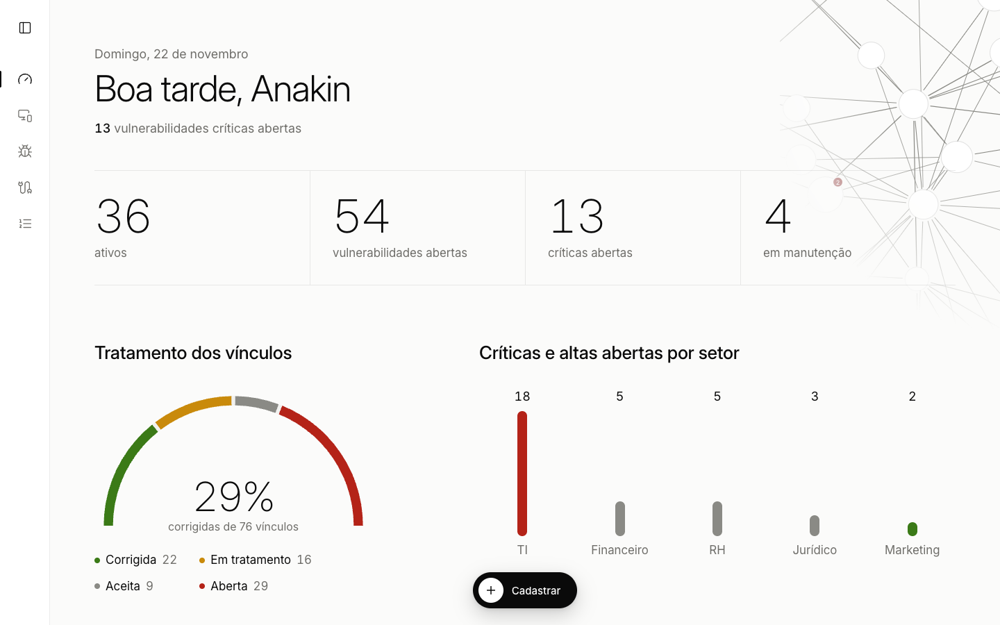
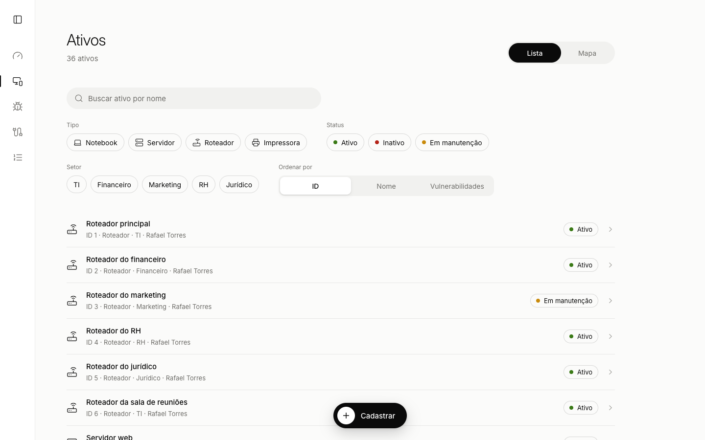
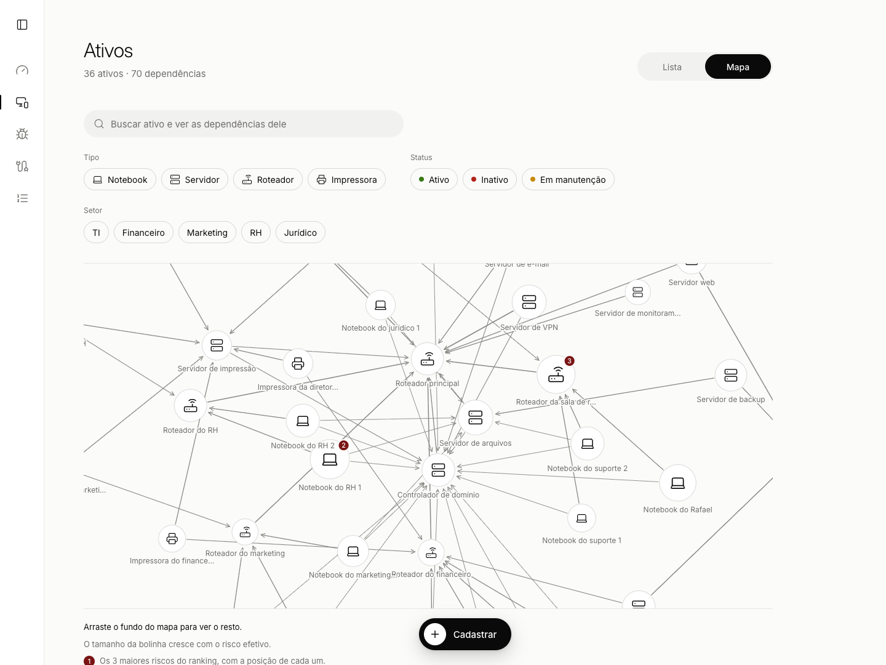
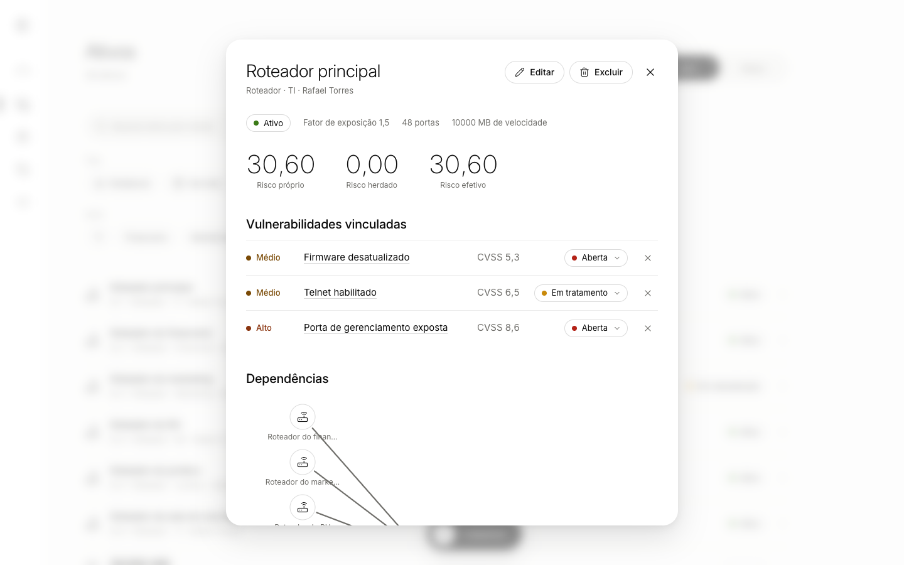
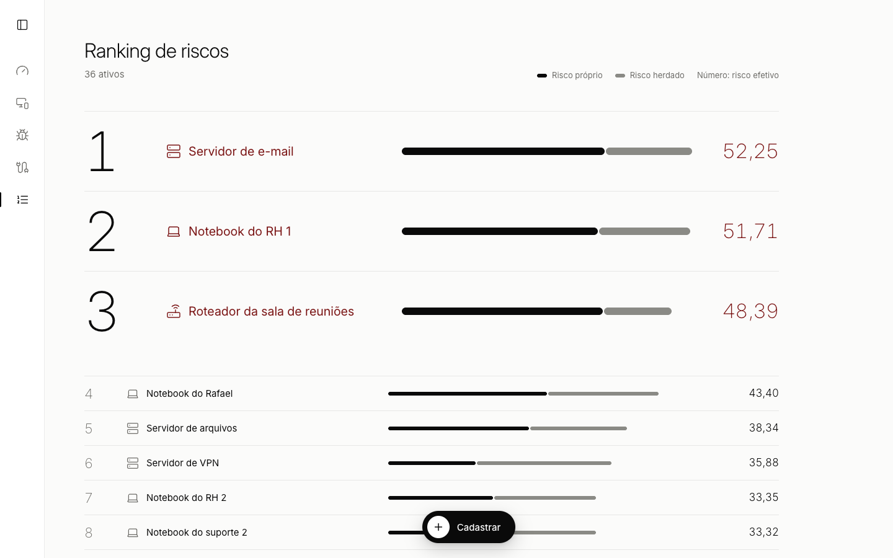
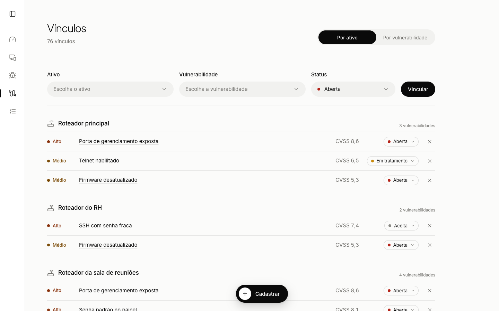
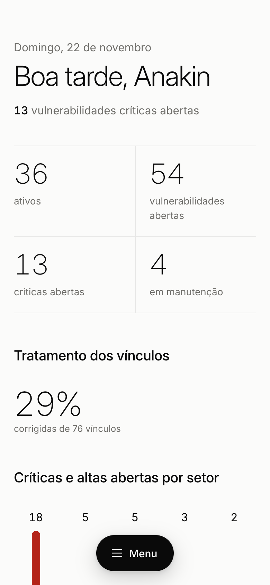
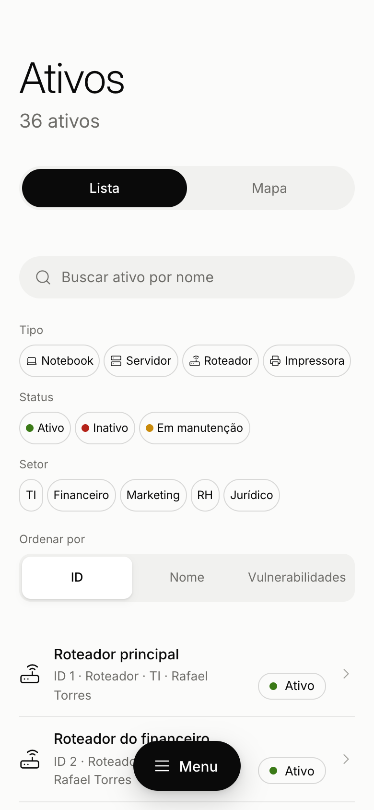
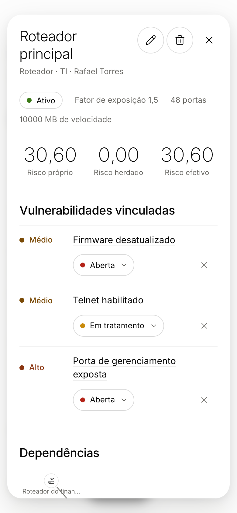
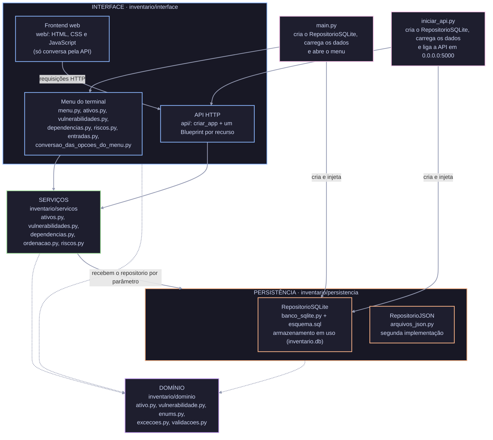

# Gerenciador de Ativos e Vulnerabilidades de TI

*[Read in English](../README.md)*

Aplicação em Python para cadastro e gestão de ativos de TI e suas vulnerabilidades, com análise de risco baseada em álgebra linear. Pode ser usada por um menu de linha de comando (CLI), por uma API HTTP que roda em um container Docker ou por um frontend web servido por essa mesma API. Projeto de estudo do curso de Cibersegurança da UFU, com foco em boas práticas de código: nomenclatura clara, funções com responsabilidade única, arquitetura em camadas, programação orientada a objetos e tratamento de erros sem exposição de dados internos.

**Aluno:** Cadu Lugaresi · Cibersegurança UFU, turma 2 · semestre 2026/2 · Trabalho 2



## ✨ Como executar

Baixe o projeto:

```bash
git clone https://github.com/cadulugaresi/trab02_2026_2_12621cbs211.git
cd trab02_2026_2_12621cbs211
```

### Com Docker (recomendado)

Pré-requisito: Docker com Docker Compose.

```bash
docker compose up -d --build     # constrói a imagem e sobe o sistema em segundo plano
docker compose ps                # o container deve aparecer como "healthy"
docker compose logs -f           # acompanha os logs (Ctrl + C para sair)
docker compose down              # para tudo; os dados continuam guardados no volume
```

- **Sistema (frontend e API):** `http://localhost:2211`
- **Verificação de funcionamento:** `http://localhost:2211/saude`

O container roda a API e o frontend web, guarda o banco no volume `dados`, reinicia sozinho se o processo parar e fica marcado como `healthy` enquanto o `/saude` responde. O código, inclusive o do frontend, é copiado para a imagem quando ela é construída: depois de alterar qualquer arquivo, rode `docker compose up -d --build` de novo, senão o container continua com a versão antiga. Detalhes em `docs/docker.md`.

Os nomes seguem a padronização da disciplina (card S5_20): o projeto Compose, a imagem e o container se chamam `trab02_2026_2_12621cbs211`, e a porta externa é a 2211 (2000 + os três últimos dígitos da matrícula). Dentro do container, a API continua escutando na porta 5000. O passo a passo da implantação no servidor da faculdade, com as evidências das 24 horas, está no `docs/implantacao.md`.

### Sem Docker

Pré-requisito: Python 3.8 ou superior. As dependências externas são o `numpy` e o `flask`, listados no `requirements.txt`.

```bash
python3 -m pip install -r requirements.txt
python3 iniciar_api.py
```

- **Sistema (frontend e API):** `http://localhost:5000`

> No Windows, use `python` no lugar de `python3`.

Na primeira execução, o banco `inventario.db` é criado automaticamente na pasta em que o comando foi rodado, com as tabelas do `inventario/persistencia/esquema.sql`.

O servidor atende uma requisição por vez (`threaded=False`, explicado no `docs/docker.md`). Os navegadores abrem conexões extras com antecedência e as deixam paradas, então o `iniciar_api.py` fecha qualquer conexão que fique parada por mais de 1 segundo; sem isso, uma única conexão parada prenderia o servidor e a página deixaria de carregar. O frontend também envia as requisições em fila, uma depois da outra, com tempo limite de 10 segundos.

### Dados de demonstração

Para ver o sistema cheio (36 ativos, 16 vulnerabilidades, 76 vínculos e 70 dependências, todos com o responsável fictício Rafael Torres), rode o `semear_demonstracao.py` com a API no ar:

```bash
python3 semear_demonstracao.py                         # API local, em http://localhost:5000
python3 semear_demonstracao.py http://localhost:2211   # API no Docker
```

Os dados entram pela própria API, passando pelas mesmas validações de um cadastro feito à mão. O script só carrega a demonstração num banco **vazio**: se já existir algum ativo, ele para sem cadastrar nada, para nunca misturar os dados fictícios com dados de verdade. Para manter a demonstração separada do seu banco, rode a API numa pasta própria:

```bash
mkdir demonstracao
cd demonstracao
python3 ../iniciar_api.py
```

e, em outro terminal, na pasta do projeto, `python3 semear_demonstracao.py`.

### Menu no terminal

```bash
python3 main.py
```

O programa abre um menu interativo no terminal. Basta seguir as opções numeradas para cadastrar ativos, gerenciar vulnerabilidades e salvar os dados. O menu é para uso local e não faz parte do container. Não rode o menu no mesmo banco enquanto a API estiver no ar: a API carrega os dados na memória ao iniciar e não veria as alterações feitas pelo menu.

```
1 - Cadastrar ativo
2 - Listar ativos
3 - Editar ativo
4 - Excluir ativo
5 - Menu de vulnerabilidades
6 - Menu de dependências
7 - Análise de risco
8 - Sair
```

Dentro da opção 2 (Listar ativos), é possível listar **todos**, **filtrar** por tipo ou status, ou mostrar **um** ativo buscando por nome ou ID.

Dentro da opção 3 (Editar ativo), um submenu permite atualizar responsável, status, setor, atributos específicos ou o tipo de um ativo. As alterações são salvas ao escolher "Voltar".

Dentro da opção 5 (Menu de vulnerabilidades), um submenu gerencia o catálogo e os vínculos entre vulnerabilidades e ativos:

```
1 - Cadastrar vulnerabilidade
2 - Listar catálogo de vulnerabilidades
3 - Editar vulnerabilidade no catálogo
4 - Excluir vulnerabilidade do catálogo
5 - Vincular vulnerabilidade a um ativo
6 - Listar vulnerabilidades de um ativo
7 - Atualizar status da vulnerabilidade em um ativo
8 - Desvincular vulnerabilidade de um ativo
9 - Voltar ao menu principal
```

### Testes

```bash
python3 -m unittest discover -s tests
python3 -m pytest tests/test_exemplos.py
python3 -m flake8 main.py iniciar_api.py semear_demonstracao.py inventario
python3 -m black --check .
```

Os testes de integração pelo Postman e a organização da pasta `tests/` estão na seção [Testes](#-testes).

## 🫧 Funcionalidades

### Ativos
Cada tipo de ativo é uma **subclasse própria** de `Ativo`, com atributos específicos:

- **Notebook**: sistema operacional (Windows, macOS, Linux ou outro, digitado), tamanho de tela
- **Servidor**: quantidade de RAM, armazenamento
- **Roteador**: quantidade de portas, velocidade
- **Impressora**: cor (colorida / preto e branco), tecnologia (tinta / laser)

**Operações disponíveis:**
- **Cadastro**: ID, nome, tipo, setor (TI / Financeiro / Marketing / RH / Jurídico), responsável, status (Ativo / Inativo / Em manutenção) e atributos específicos do tipo escolhido, todos com validação de entradas.
- **Listagem**: exibe todos os ativos, filtra por **tipo** ou por **status**, ou mostra um ativo buscando por **ID** ou por **nome/hostname** (busca parcial, case-insensitive).
- **Edição**: atualiza responsável, status, setor e atributos específicos, ou **troca o tipo** do ativo mantendo as vulnerabilidades vinculadas.
- **Exclusão**: remove um ativo pelo ID, com confirmação antes da exclusão.

### Vulnerabilidades
As vulnerabilidades ficam em um **catálogo** único, independente dos ativos. Cada ativo guarda apenas uma **referência** (o ID da vulnerabilidade) e o **status de tratamento** daquela vulnerabilidade nele. Assim, uma mesma vulnerabilidade pode estar aberta em um ativo e corrigida em outro, e corrigir seus dados no catálogo atualiza todos os ativos vinculados de uma vez.

- **Cadastro no catálogo**: nome e **nota CVSS** (de 0.1 a 10.0, aceitando vírgula como separador decimal e arredondada para uma casa), com ID gerado automaticamente
- **Nível de severidade**: calculado a partir da nota CVSS pelas faixas oficiais (Baixo / Médio / Alto / Crítico), então nunca contradiz a nota
- **Vínculo**: liga uma vulnerabilidade do catálogo a um ativo, com status de tratamento (Aberta / Em tratamento / Corrigida / Aceita)
- **Listagem**: exibe o catálogo inteiro, ou as vulnerabilidades de um ativo com o status de cada uma nele
- **Atualização de status**: muda o status de tratamento de uma vulnerabilidade em um ativo específico
- **Desvínculo**: tira uma vulnerabilidade de um ativo, mantendo-a no catálogo
- **Edição no catálogo**: corrige o nome ou a nota CVSS
- **Exclusão do catálogo**: remove uma vulnerabilidade do catálogo e de todos os ativos vinculados, com confirmação

> **Em desenvolvimento:** integração com o CVE para identificação de vulnerabilidades conhecidas.

### Análise de Risco
Modelo baseado em álgebra linear que estima o risco de cada ativo a partir de suas vulnerabilidades e das dependências entre ativos. O cálculo fica em `inventario/servicos/riscos.py` e usa o `numpy`:

- **Matriz `M`** (ativos × vulnerabilidades): `1` quando a vulnerabilidade está vinculada ao ativo com status Aberta, Em tratamento ou Aceita; `0` quando está Corrigida ou não está vinculada
- **Vetor `v`**: a nota CVSS de cada vulnerabilidade do catálogo
- **Fator de exposição `f`**: um peso por ativo. Cada subclasse tem o seu padrão em `FATOR_EXPOSICAO_PADRAO` (Notebook 1.2, Servidor 1.3, Roteador 1.5, Impressora 0.9), e o valor pode ser alterado em cada ativo no cadastro e na edição, maior que 0 e no máximo 2
- **Risco próprio**: `b = f × (M @ v)`
- **Matriz `A`** (ativos × ativos): `A[i][j]` é a fração do risco que o ativo `i` herda do ativo `j`, tirada das dependências
- **Risco efetivo**: a solução de `(I − A)x = b` com `np.linalg.solve`. Antes de resolver, o programa confere se o determinante de `I − A` não é quase zero (tolerância `1e-10`); se for, mostra um erro pedindo para revisar as frações das dependências
- **Risco herdado**: risco efetivo − risco próprio
- **Ranking**: os ativos ordenados pelo risco efetivo, do maior para o menor (`AnaliseDeRisco.ranking()`)

A opção 7 do menu principal mostra uma linha por ativo, na ordem do ranking, com o fator de exposição e os riscos próprio, herdado e efetivo, seguida de uma legenda. O mesmo ranking está disponível pela API, em `GET /riscos`, e no frontend, na tela Ranking de riscos.

### Geral
- **Persistência de dados**: os ativos, o catálogo e os vínculos são salvos em um banco SQLite (`inventario.db`), com uma tabela por tipo de ativo e a tabela associativa `vinculos` entre ativos e vulnerabilidades, e recarregados a cada execução
- **Armazenamento substituível**: os serviços recebem um `repositorio` como parâmetro (injeção de dependência feita pelos pontos de entrada, `main.py` e `iniciar_api.py`) e não importam a persistência; o `RepositorioSQLite` é o armazenamento em uso, e o `RepositorioJSON` (arquivos JSON) é mantido como segunda implementação, que oferece as mesmas operações, o que é garantido pela suíte de testes de contrato
- **Índice por ID**: ativos e vulnerabilidades do catálogo são armazenados em dicionários indexados por ID, permitindo busca eficiente e em tempo constante (O(1))
- **Tratamento de erro global**: Ctrl+C e Ctrl+D em qualquer ponto do programa encerram de forma limpa, sem traceback

## ✨ Tecnologias

- Python 3.8+
- Módulos da biblioteca padrão: `sqlite3`, `abc`, `json`, `enum`
- Banco de dados: SQLite (sem servidor para instalar; esquema em `inventario/persistencia/esquema.sql`)
- Álgebra linear: `numpy` (listado no `requirements.txt`)
- API HTTP: `flask` (listado no `requirements.txt`)
- Frontend web: HTML, CSS e JavaScript (módulos ES), servido pelo próprio Flask, sem framework e sem etapa de build
- Testes: `unittest`, `pytest` e uma coleção do Postman; padronização: `flake8` e `black`; integração contínua com GitHub Actions
- Container: Docker e Docker Compose, rodando a API com um volume para o banco, uma política de reinício e uma verificação de funcionamento em `/saude` (detalhes em `docs/docker.md`)

## 🫧 Rotas da API

Uma API Flask expõe todas as operações do menu como um serviço HTTP na porta 5000, para que outros programas (como o frontend web) possam usar o sistema. As requisições e as respostas usam JSON, com as mesmas chaves que o `para_dicionario()` produz; as respostas de vulnerabilidade também trazem o nível de severidade (`"nivel": "CRITICO"`).

| Método | Rota                                      | O que faz                                                                                                                        |
| ------ | ----------------------------------------- | -------------------------------------------------------------------------------------------------------------------------------- |
| GET    | `/saude`                                  | Verificação de funcionamento: devolve `{"status": "ok"}`                                                                         |
| GET    | `/opcoes`                                 | Listas para os formulários: tipos (com o fator de exposição padrão), setores, status, cores, tecnologias e sistemas operacionais |
| GET    | `/ativos`                                 | Lista os ativos, com filtros e ordenação opcionais                                                                               |
| POST   | `/ativos`                                 | Cadastra um ativo de qualquer tipo (201)                                                                                         |
| GET    | `/ativos/<id>`                            | Devolve um ativo                                                                                                                 |
| PUT    | `/ativos/<id>`                            | Edita um ativo, inclusive trocando o tipo                                                                                        |
| DELETE | `/ativos/<id>`                            | Exclui um ativo (204)                                                                                                            |
| GET    | `/ativos/<id>/vulnerabilidades`           | Vulnerabilidades de um ativo, com nome, CVSS, nível e status de tratamento                                                       |
| POST   | `/ativos/<id>/vulnerabilidades`           | Vincula uma vulnerabilidade do catálogo a um ativo (201)                                                                         |
| PUT    | `/ativos/<id>/vulnerabilidades/<id_vuln>` | Atualiza o status de tratamento de um vínculo                                                                                    |
| DELETE | `/ativos/<id>/vulnerabilidades/<id_vuln>` | Desvincula uma vulnerabilidade de um ativo (204)                                                                                 |
| GET    | `/ativos/<id>/dependencias`               | Dependências de um ativo, com o nome do ativo do qual ele depende                                                                |
| POST   | `/ativos/<id>/dependencias`               | Adiciona uma dependência (201)                                                                                                   |
| PUT    | `/ativos/<id>/dependencias/<id_dep>`      | Troca o ativo do qual depende e/ou a fração                                                                                      |
| DELETE | `/ativos/<id>/dependencias/<id_dep>`      | Remove uma dependência (204)                                                                                                     |
| GET    | `/vulnerabilidades`                       | Lista o catálogo de vulnerabilidades                                                                                             |
| POST   | `/vulnerabilidades`                       | Cadastra uma vulnerabilidade; o ID é gerado pelo servidor (201)                                                                  |
| GET    | `/vulnerabilidades/<id>`                  | Devolve uma vulnerabilidade                                                                                                      |
| PUT    | `/vulnerabilidades/<id>`                  | Edita o nome e/ou o CVSS                                                                                                         |
| DELETE | `/vulnerabilidades/<id>`                  | Exclui do catálogo e desvincula de todos os ativos (204)                                                                         |
| GET    | `/riscos`                                 | Ranking de risco com os riscos próprio, herdado e efetivo                                                                        |
| GET    | `/` e `/web/<arquivo>`                    | Página e arquivos do frontend web                                                                                                |

O `GET /ativos` aceita filtros e ordenação na query string, que podem ser combinados: `tipo` (ex.: `Notebook`), `status` (ex.: `1`), `nome` (parte do nome, sem diferenciar maiúsculas) e `ordenar` (`id`, `nome` ou `vulnerabilidades`). Exemplo: `/ativos?tipo=Notebook&status=1&ordenar=nome`.

**Edição e exclusão:** o `PUT /ativos/<id>` recebe o ativo inteiro; o ID da URL é o que vale, e se o `fator_exposicao` não vier e o tipo não mudar, o fator atual é mantido. No `PUT` de vulnerabilidades e de dependências, o campo que não vier, ou vier `null`, continua com o valor atual. Excluir um ativo também remove as dependências que apontavam para ele, e excluir uma vulnerabilidade a desvincula de todos os ativos.

Exemplo de cadastro de um ativo:

```bash
curl -X POST http://localhost:5000/ativos \
  -H "Content-Type: application/json" \
  -d '{"tipo": "Notebook", "id": 10, "nome": "Notebook do Rafael", "setor": 1, "responsavel": "Rafael Torres", "status": 1, "sistema_operacional": "Linux", "tela": 14.0}'
```

### Códigos de status e erros

Toda resposta de erro é um JSON no mesmo formato, `{"erro": "mensagem em texto"}`, nunca uma página HTML, para o frontend poder mostrar a mensagem diretamente.

| Status | Quando                                                                                                          |
| ------ | --------------------------------------------------------------------------------------------------------------- |
| 200    | Consulta ou edição bem-sucedida                                                                                 |
| 201    | Cadastro de ativo, vulnerabilidade, vínculo ou dependência                                                      |
| 204    | Exclusão ou desvínculo bem-sucedido, sem corpo na resposta                                                      |
| 400    | Dados ou filtros inválidos: regra do domínio violada, campo faltando ou corpo que não é JSON                    |
| 404    | Ativo, vulnerabilidade, vínculo, dependência ou rota que não existe (inclusive ID em texto, como `/ativos/abc`) |
| 405    | Método que a rota não aceita                                                                                    |
| 409    | Dados que impedem a análise de risco em `GET /riscos`                                                           |
| 413    | Requisição maior que 64 KB                                                                                      |
| 500    | Falha do banco ou erro inesperado, sem detalhes internos                                                        |

As regras de cada campo, com as mensagens exatas, estão no `docs/validacoes.md`.

## ✨ Frontend

A API também serve uma aplicação web: o Flask entrega a página em `/` e os arquivos dela em `/web/...`, na mesma porta da API. Ela só conversa com o sistema pelas rotas HTTP acima.

- **Início**: saudação, as vulnerabilidades abertas mais graves, os totais, o status de tratamento dos vínculos, as vulnerabilidades críticas e altas por setor, os 5 ativos de maior risco e uma prévia do mapa dos ativos
- **Ativos**: lista com busca, filtros (tipo, status e setor) e ordenação, ou um mapa das dependências entre os ativos, com os mesmos filtros e uma busca que mostra só as dependências do ativo encontrado
- Telas de **Vulnerabilidades**, **Vínculos** e **Ranking de riscos**, além das janelas de detalhes e dos formulários de cadastro e edição

| Ativos                                                                                                                       | Mapa das dependências                                                                        |
| :--------------------------------------------------------------------------------------------------------------------------: | :------------------------------------------------------------------------------------------: |
|                                                         |  |
| **Detalhes de um ativo**                                                                                                     | **Ranking de riscos**                                                                        |
|  |              |



No celular, a navegação vira um botão de menu, os filtros ficam mais compactos e as janelas viram um cartão sobre a tela:

<p align="center">
  
  
  
</p>

```
inventario/interface/web/
├── index.html                     # página única: carrega o tema, os estilos e o principal.js
├── js/
│   ├── principal.js               # ponto de entrada: carrega os ícones, monta a navegação e liga o roteador
│   ├── roteador.js                # roteador por "#" (/#/ativos, /#/ativos/12...): telas e janelas
│   ├── rotas.js                   # tabela de rotas: endereço → tela ou janela
│   ├── api.js                     # único arquivo que chama a API; os erros viram ErroDaApi com a mensagem da API
│   ├── conexao.js                 # fila de requisições, com tempo limite de 10 segundos
│   ├── navegacao.js               # faixa de ícones, menu lateral com submenus e botão Cadastrar
│   ├── camadas.js                 # pilha de janelas, balões e menus (Esc, clique fora e foco)
│   ├── elementos.js               # cria os elementos sempre com textContent, nunca com innerHTML
│   ├── opcoes.js, rotulos.js      # listas da API (/opcoes) e nomes para exibir
│   ├── formatos.js, validacoes.js # números no formato brasileiro e validações dos formulários
│   ├── riscos.js                  # busca o ranking (/riscos) e trata o 409
│   ├── icones.js, animacoes.js, posicionamento.js  # ícones SVG, transições e posição dos balões
│   ├── componentes/               # botões, campos, segmentado, contador, janela, balões, avisos...
│   └── telas/                     # uma pasta por tela: inicio/, ativos/, mapa/, vulnerabilidades/, vinculos/, ranking/
├── estilos/
│   ├── tema-macos.css             # variáveis do tema: cores, fontes, espaços, raios e durações
│   ├── principal.css              # importa todos os outros arquivos de estilo
│   ├── base.css, navegacao.css    # estilos gerais e da navegação
│   ├── componentes/               # um arquivo por componente
│   └── telas/                     # um arquivo por tela
├── fontes/                        # fonte Inter (woff2), com a licença SIL OFL
└── icones/                        # ícones Lucide (SVG), com a licença ISC
```

- **Tecnologia**: HTML, CSS e JavaScript puros (módulos ES), sem framework, sem etapa de build e sem CDN; a fonte e os ícones ficam dentro do projeto
- **Comunicação com a API**: só o `js/api.js` usa `fetch`, e todas as chamadas passam pela fila do `js/conexao.js`. Quando a API devolve um erro, a mensagem do `{"erro": ...}` aparece na tela
- **Validação**: os formulários conferem os dados antes de enviar (campos obrigatórios, faixas de valor, opções vindas de `/opcoes`), com as mesmas mensagens do domínio; a API confere tudo de novo, venha o dado de onde vier
- **Segurança**: todo texto que vem da API é mostrado com `textContent`, nunca com `innerHTML`, então um nome com tags HTML aparece como texto comum (sem XSS). Toda resposta do servidor também leva cabeçalhos de segurança: `Content-Security-Policy` (só scripts e estilos do próprio servidor), `X-Frame-Options: DENY` (o sistema não pode ser mostrado dentro de outro site, o que bloqueia o clickjacking), `X-Content-Type-Options: nosniff` e `Referrer-Policy: no-referrer`. A API recusa textos com mais de 120 caracteres e requisições maiores que 64 KB
- **Responsivo e acessível**: layouts para celular, tablet, computador e telas grandes (larguras de referência de 390, 768, 1024, 1440 e 1600px ou mais), navegação por teclado com contorno de foco visível e movimento reduzido quando o sistema pede
- **Decisões de design**: registradas no `PRODUCT.md` e no `DESIGN.md`

## 🫧 Arquitetura

O projeto é organizado em **camadas**. Cada camada é um pacote dentro de `inventario/` e tem uma única responsabilidade:



**Regra de dependência:** as setas só apontam para baixo. A interface chama os serviços, e os serviços usam o `repositorio` que recebem como parâmetro, sem importar a persistência. Há dois pontos de entrada, e eles são os únicos arquivos que sabem qual implementação é usada: o `main.py` cria o `RepositorioSQLite` e o injeta no menu, que o repassa para as telas da interface e para os serviços; o `iniciar_api.py` cria o `RepositorioSQLite` e o injeta no `criar_app`, cujas rotas o repassam para os serviços. O menu e a API ficam lado a lado na camada de interface e chamam os mesmos serviços, então nenhuma regra de negócio é duplicada entre eles. O frontend web não acessa nada diretamente: ele só faz requisições HTTP para a API. As duas implementações (`RepositorioSQLite` e `RepositorioJSON`) oferecem as mesmas operações, e isso é garantido pela suíte de testes de contrato. Todas as camadas podem usar o domínio (setas tracejadas), mas o domínio não importa nenhuma outra camada.

### Responsabilidade de cada camada

- **Interface** (`inventario/interface/`): é a única camada que conversa com o mundo de fora. O menu do terminal usa `input` e `print`; a API recebe requisições HTTP e responde com JSON. Os dois leem e convertem as entradas e apresentam os resultados e as mensagens de erro.
  - `api/`: o pacote da API. O `__init__.py` tem o `criar_app(repositorio, ativos, catalogo)`, que cria o app Flask, registra os tratadores de erro (sempre em JSON), o limite de tamanho das requisições e os cabeçalhos de segurança, e registra um Blueprint por recurso (`rotas_de_ativos.py`, `rotas_de_vulnerabilidades.py`, `rotas_de_vinculos.py`, `rotas_de_dependencias.py`, `rotas_de_riscos.py`, `rotas_de_opcoes.py`, `rotas_de_saude.py`, `rotas_do_frontend.py`); o `requisicoes.py` e o `respostas.py` guardam ajudantes pequenos para ler os corpos e montar as respostas
  - `web/`: o frontend web (HTML, CSS e JavaScript), servido pelo `api/rotas_do_frontend.py`; ele só conversa com o sistema pelas rotas HTTP da API
  - `menu.py`: `menu_principal`, `menu_listagem` e `menu_vulnerabilidades`
  - `ativos.py`: telas de cadastro, edição e exclusão de ativos (`cadastrar_ativo`, `editar_ativo`, `excluir_ativo`, `perguntar_ativo`...)
  - `vulnerabilidades.py`: telas do catálogo e dos vínculos (`cadastrar_vulnerabilidade`, `editar_vulnerabilidade`, `vincular_a_um_ativo`, `mostrar_vulnerabilidade`...)
  - `dependencias.py`: telas das dependências entre ativos (`cadastrar_dependencia_menu`, `atualizar_dependencia_menu`, `excluir_dependencia_menu`...)
  - `riscos.py`: `analisar_risco`, a tabela do ranking de risco no terminal
  - `entradas.py`: funções `pedir_*`, que leem e validam o que foi digitado
  - `conversao_das_opcoes_do_menu.py`: converte a opção numerada do menu no valor do domínio (`"1"` → `StatusDoAtivo.ATIVO`, `"1"` → `Notebook`...)
- **Serviços** (`inventario/servicos/`): concentram as operações de cadastro, busca, edição, exclusão e associação. Recebem o repositório e os dados prontos por parâmetro, aplicam as regras, salvam pelo repositório (`repositorio.adicionar_ativo`, `repositorio.vincular`...) e lançam `DadoInvalidoError` quando algo está errado. Não usam `input` nem `print`.
  - `ativos.py`: `registrar_ativo_no_inventario`, `atualizar_ativo_no_inventario`, `remover_ativo_do_inventario`, `obter_ativo` e as buscas (`encontrar_ativo_por_id`, `encontrar_ativos_por_nome`, `encontrar_ativos_por_status`, `encontrar_ativos_por_tipo`)
  - `vulnerabilidades.py`: `registrar_vulnerabilidade_no_catalogo`, `atualizar_vulnerabilidade_no_catalogo`, `excluir_vulnerabilidade_do_catalogo`, `vincular_vulnerabilidade`, `desvincular_vulnerabilidade`, `atualizar_status_vulnerabilidade`, `obter_vulnerabilidade` e `proximo_id`
  - `dependencias.py`: `cadastrar_dependencia`, `atualizar_dependencia` e `remover_dependencia`, com a regra de que a soma das frações de um ativo fica abaixo de 1
  - `ordenacao.py`: `listar_ativos_ordenados`, por ID, nome ou quantidade de vulnerabilidades
  - `riscos.py`: `AnaliseDeRisco`, que monta as matrizes `M` e `A` e os vetores `v` e `f` e resolve o sistema com o `numpy`
- **Persistência** (`inventario/persistencia/`): salva e carrega os dados e traduz as falhas do armazenamento em `PersistenciaError`. As duas implementações oferecem as mesmas 14 operações, conferidas pela suíte de testes de contrato: `carregar_ativos`, `carregar_catalogo`, `adicionar_ativo`, `atualizar_ativo`, `remover_ativo`, `adicionar_vulnerabilidade`, `atualizar_vulnerabilidade`, `remover_vulnerabilidade`, `vincular`, `atualizar_status_vinculo`, `desvincular`, `adicionar_dependencia`, `remover_dependencia` e `atualizar_dependencia`.
  - `banco_sqlite.py`: `RepositorioSQLite`, o armazenamento usado pelo programa (`inventario.db`); cria as tabelas ao iniciar, liga as chaves estrangeiras e remonta cada ativo com um `JOIN` entre `ativos` e a tabela do tipo dele
  - `esquema.sql`: o esquema do banco: a tabela `ativos`, uma tabela por tipo (`notebooks`, `servidores`, `roteadores`, `impressoras`), `vulnerabilidades` e a tabela associativa `vinculos`, todas com `ON DELETE CASCADE`
  - `arquivos_json.py`: `RepositorioJSON`, a segunda implementação, que salva em `ativos.json` e `vulnerabilidades.json` com escrita atômica
- **Domínio** (`inventario/dominio/`): as entidades e as regras que valem em qualquer interface, sem depender de ninguém.
  - `ativo.py`: `Ativo` e as subclasses `Notebook`, `Servidor`, `Roteador`, `Impressora`, além do `MAPA_DE_TIPOS`
  - `vulnerabilidade.py`: `Vulnerabilidade`, com o nível calculado pela nota CVSS
  - `enums.py`: `Setor`, `StatusDoAtivo`, `StatusDaVuln`, `NivelDaVulnerabilidade`, `Cor`, `Tecnologia`, `SistemaOperacional`
  - `excecoes.py`: `DadoInvalidoError`, a filha dela `RecursoNaoEncontradoError` e `PersistenciaError`
  - `validacoes.py`: regras de validação (`validar_texto_obrigatorio`, `validar_cvss`, `validar_fator_exposicao`...)

### Exemplo de fluxo: excluir um ativo

```
menu_principal                         (interface)     usuário escolhe a opção 4
└── excluir_ativo                      (interface)
    ├── perguntar_ativo                (interface)     pede o ID
    │   └── obter_ativo                (serviço)       busca; lança erro se não existir
    ├── confirmar_exclusao             (interface)     pede "sim"
    └── remover_ativo_do_inventario    (serviço)       apaga do inventário
        └── repositorio.remover_ativo  (persistência)  DELETE FROM ativos (ON DELETE CASCADE)
```

### Decisões de projeto

- **Serviços recebem IDs, não perguntas:** todo serviço trabalha com dados prontos (ex.: `remover_ativo_do_inventario(ativos, id_ativo)`). Assim, a mesma regra pode ser usada pelo menu do terminal ou por uma API, sem depender de `input`.
- **Erros sobem, a interface mostra:** os serviços e o domínio lançam `DadoInvalidoError` com a mensagem; a interface captura e exibe essa mensagem. O texto de cada erro fica escrito em um lugar só.
- **"Não encontrado" tem um erro próprio:** o `RecursoNaoEncontradoError` é filho de `DadoInvalidoError`. O menu continua capturando os dois do mesmo jeito, e a API responde 404 para ele e 400 para qualquer outro dado inválido.
- **Banco primeiro, memória depois:** todo serviço grava no banco antes de mudar os dicionários em memória, e as telas de edição do menu trabalham sobre uma cópia. Se a gravação falhar, a memória continua igual ao banco.
- **Validação em profundidade:** regras como a faixa do CVSS (`validar_cvss`), o nome e o responsável do ativo (`validar_texto_obrigatorio`) e o fator de exposição (`validar_fator_exposicao`) ficam no domínio e são usadas tanto pelo menu (para pedir de novo) quanto pelos serviços (como garantia, venha o dado de onde vier). Como a API chama os serviços diretamente, uma requisição HTTP com dados inválidos é recusada pelas mesmas regras do menu.
- **Uma lista de tipos só:** a lista de tipos de ativo mora no domínio (`MAPA_DE_TIPOS`); a numeração do menu (`TIPOS_DE_ATIVOS`) é gerada a partir dela pela interface.
- **Depender da abstração:** os serviços recebem um `repositorio` por parâmetro, em vez de importar um módulo de armazenamento. Trocar os arquivos JSON pelo banco SQLite mexeu só na camada de persistência e no repositório criado no ponto de entrada.
- **Cada operação salva só o que mudou:** em vez de regravar tudo, cada serviço chama a operação correspondente do repositório (`adicionar_ativo`, `desvincular`...), que vira um único `INSERT`, `UPDATE` ou `DELETE` no banco.
- **Uma segunda interface sem mexer nas regras:** a API HTTP entrou como um pacote novo na camada de interface (`api/`) e um ponto de entrada novo (`iniciar_api.py`). Os serviços só ganharam as validações que antes eram chamadas apenas pelo menu.
- **A API recebe as suas dependências:** o `criar_app` recebe o repositório e os dados em vez de criá-los, assim como o `menu_principal`. Isso permite que os testes da API criem o app com um banco SQLite em memória, sem mexer no `inventario.db`.

### Modelo do domínio

- **Hierarquia de classes**: `Ativo` (base) + `Notebook`, `Servidor`, `Roteador`, `Impressora` (subclasses)
- **Polimorfismo**: cada subclasse sobrescreve `exibir_detalhes()` e adiciona seus atributos específicos
- **Catálogo de vulnerabilidades**: objetos `Vulnerabilidade` guardados no dicionário `catalogo[id]`; cada ativo mantém um dicionário de vínculos `{id_vulnerabilidade: StatusDaVuln}` (referência, não cópia)
- **Nível calculado**: `Vulnerabilidade.nivel()` obtém o nível de severidade a partir da nota CVSS
- **Serialização / desserialização**: `para_dicionario()` converte objetos em dicionários; `de_dicionario()` (método de classe) reconstrói objetos a partir de dicionários
- **Índice por ID**: dicionários `ativos[id]` e `catalogo[id]` para busca O(1)

## ✨ Estrutura do projeto

```
.
├── main.py                              # ponto de entrada do menu no terminal
├── iniciar_api.py                       # ponto de entrada da API e do frontend (porta 5000)
├── semear_demonstracao.py               # carrega os dados de demonstração pela API, num banco vazio
├── requirements.txt                     # dependências: numpy e flask
├── Dockerfile                           # imagem da API, com usuário sem privilégios e healthcheck
├── compose.yaml                         # container trab02_2026_2_12621cbs211: porta 2211, volume e reinício automático
├── .dockerignore                        # o que fica fora da imagem (testes, documentação, bancos locais...)
├── inventario/
│   ├── interface/                       # camada de interface
│   │   ├── api/                         # API HTTP (Flask)
│   │   │   ├── __init__.py              # criar_app: erros em JSON, limite de 64 KB, cabeçalhos de segurança e Blueprints
│   │   │   ├── rotas_de_ativos.py       # /ativos
│   │   │   ├── rotas_de_vulnerabilidades.py  # /vulnerabilidades
│   │   │   ├── rotas_de_vinculos.py     # /ativos/<id>/vulnerabilidades
│   │   │   ├── rotas_de_dependencias.py # /ativos/<id>/dependencias
│   │   │   ├── rotas_de_riscos.py       # /riscos
│   │   │   ├── rotas_de_opcoes.py       # /opcoes
│   │   │   ├── rotas_de_saude.py        # /saude
│   │   │   ├── rotas_do_frontend.py     # entrega a página em / e os arquivos em /web/...
│   │   │   ├── requisicoes.py           # lê os campos opcionais dos corpos
│   │   │   └── respostas.py             # monta a resposta da vulnerabilidade, com o nível
│   │   ├── web/                         # frontend web (detalhes na seção Frontend)
│   │   ├── menu.py                      # menus do terminal
│   │   ├── ativos.py                    # telas de ativos no terminal
│   │   ├── vulnerabilidades.py          # telas do catálogo e dos vínculos
│   │   ├── dependencias.py              # telas das dependências
│   │   ├── riscos.py                    # tabela do ranking de risco
│   │   ├── entradas.py                  # funções pedir_*, que leem e validam o que foi digitado
│   │   └── conversao_das_opcoes_do_menu.py  # opção numerada do menu → valor do domínio
│   ├── servicos/                        # regras de negócio, sem input nem print
│   │   ├── ativos.py                    # cadastro, edição, exclusão e buscas de ativos
│   │   ├── vulnerabilidades.py          # catálogo e vínculos
│   │   ├── dependencias.py              # dependências e a regra da soma das frações
│   │   ├── ordenacao.py                 # ordenação por ID, nome ou quantidade de vulnerabilidades
│   │   └── riscos.py                    # AnaliseDeRisco: matrizes M e A, vetores v e f, numpy
│   ├── persistencia/
│   │   ├── banco_sqlite.py              # RepositorioSQLite, o armazenamento em uso
│   │   ├── esquema.sql                  # tabelas do banco, com ON DELETE CASCADE
│   │   └── arquivos_json.py             # RepositorioJSON, a segunda implementação
│   └── dominio/
│       ├── ativo.py                     # Ativo e as subclasses de cada tipo
│       ├── vulnerabilidade.py           # Vulnerabilidade, com o nível calculado pelo CVSS
│       ├── enums.py                     # setores, status, cores, tecnologias e sistemas operacionais
│       ├── excecoes.py                  # DadoInvalidoError, RecursoNaoEncontradoError e PersistenciaError
│       └── validacoes.py                # regras de validação usadas pelo menu e pelos serviços
├── tests/                               # testes automatizados (detalhes na seção Testes)
├── postman/
│   └── inventario.postman_collection.json  # testes de integração de todas as rotas, com a API rodando
├── docs/
│   ├── README.pt-br.md                  # este README, em português
│   ├── requisitos.md                    # requisitos funcionais e não funcionais
│   ├── especificacao.md                 # especificação de requisitos
│   ├── criterios_aceitacao.md           # critérios de aceitação do CRUD
│   ├── validacoes.md                    # matriz de validação, com as mensagens de cada regra
│   ├── relatorio_testes.md              # relatório de testes
│   ├── solid.md                         # relatório SOLID (S4_02)
│   ├── padroes_de_projeto.md            # padrões de projeto (S4_03)
│   ├── docker.md                        # imagem, Compose e evidências de execução
│   ├── implantacao.md                   # implantação no servidor da faculdade (S5_20)
│   ├── entrega_final.md                 # registro histórico da entrega do Trabalho 1
│   ├── imagens/                         # prints do frontend usados neste README
│   ├── referencias/                     # referências visuais do frontend
│   └── exemplos/                        # arquivos JSON de exemplo do RepositorioJSON
├── .github/workflows/testes.yml         # roda o flake8 e os testes a cada push
├── .flake8, pyproject.toml              # configuração do flake8 e do black (linhas de até 100 caracteres)
├── PRODUCT.md                           # quem usa o frontend e o que precisa fazer nele
├── DESIGN.md                            # decisões de design do frontend
└── README.md                            # este README, em inglês
```

> O banco `inventario.db` é criado automaticamente na primeira execução, com as tabelas do `esquema.sql`, e não é versionado. Os arquivos JSON usados pelo `RepositorioJSON` também não são versionados; `docs/exemplos/` tem arquivos de exemplo no mesmo formato.
>
> `docs/solid.md` é o relatório SOLID (S4_02), e as [consultas SQL](https://github.com/cadulugaresi/ciberseguranca-ufu-t2/tree/main/Sprint%204/s4_07) (no repositório de exercícios) trazem consultas comentadas com `INNER JOIN` e `LEFT JOIN` sobre o banco (S4_06), além de consultas de agregação com `COUNT`, `SUM`, `GROUP BY`, `HAVING` e `CASE` (S4_07).

## 🫧 Testes

O sistema tem **559 testes automatizados** com `unittest` (mais 7 casos parametrizados com `pytest`) e uma **coleção do Postman** que testa todas as rotas com a API rodando de verdade. Os comandos para rodar tudo estão em [Como executar › Testes](#testes).

```
tests/
├── apoio.py                             # TesteComArquivosTemporarios: pasta temporária para os testes de JSON
├── contrato_repositorio.py              # ContratoDoRepositorio: 24 testes que todo repositório precisa passar
├── test_repositorio.py                  # roda o contrato no RepositorioJSON
├── test_repositorio_sqlite.py           # roda o contrato no RepositorioSQLite, mais um banco corrompido
├── testes.py                            # validações, entidades, serviços e telas de ativos (142)
├── test_vulnerabilidades.py             # nível pelo CVSS, catálogo, vínculos e telas (94)
├── test_dependencias.py                 # dependências, a soma das frações e as telas (54)
├── test_risco.py                        # matrizes M e A, vetores v e f e o sistema linear (26)
├── test_persistencia.py                 # escrita atômica, arquivo corrompido e recarregar os dados (14)
├── test_falha_de_persistencia.py        # falha no banco não muda a memória (14)
├── test_recurso_nao_encontrado.py       # RecursoNaoEncontradoError e o 404 (15)
├── test_api.py                          # todas as rotas da API, com o test_client do Flask (130)
├── test_rotas_do_frontend.py            # página e arquivos do frontend, e cabeçalhos de segurança (15)
├── test_servidor_com_tempo_limite.py    # uma conexão parada não trava o servidor (2)
├── test_semear_demonstracao.py          # carga dos dados de demonstração (4)
└── test_exemplos.py                     # casos parametrizados com o pytest (7)
```

**Testes da API:** `tests/test_api.py` tem 130 testes que usam o `test_client()` do Flask, sem ligar o servidor. Cada teste cria o app com o `criar_app` e um banco SQLite em memória (`RepositorioSQLite(":memory:")`), e confere os códigos de status e os corpos JSON de todas as rotas, inclusive que dados inválidos devolvem 400 e não são gravados.

**Suíte de contrato do repositório:** `tests/contrato_repositorio.py` define o `ContratoDoRepositorio`, um conjunto de 24 testes que descreve o que todo repositório precisa fazer: gravar e recarregar ativos, catálogo, vínculos e dependências entre ativos; atualizá-los, inclusive trocando o tipo de um ativo; e removê-los, tirando de todos os ativos uma vulnerabilidade removida. A mesma suíte roda nas duas implementações:
- `tests/test_repositorio.py`: `TestRepositorioJSON`, com arquivos JSON temporários
- `tests/test_repositorio_sqlite.py`: `TestRepositorioSQLite`, com um banco temporário, e mais um teste que confere que um banco corrompido lança `PersistenciaError`

Os testes que salvam dados nunca mexem nos arquivos reais: os de JSON herdam de `TesteComArquivosTemporarios` (`tests/apoio.py`), e os de SQLite usam um banco temporário, apagado depois de cada teste.

### Testes de integração (Postman)

A coleção `postman/inventario.postman_collection.json` testa **todas as rotas** com a API rodando de verdade: 57 requisições e 178 verificações, em 8 pastas que rodam em ordem:

```
01 · Saúde, opções e frontend   → /saude, /opcoes, a página e os arquivos /web
02 · Ativos                     → um de cada tipo, filtros, ordenação, edição e erros de validação
03 · Vulnerabilidades           → nível pelo CVSS, ID gerado pela API, CVSS acima de 10 e corpo acima de 64 KB
04 · Vínculos                   → vincular, vínculo repetido, vulnerabilidade fora do catálogo e troca de status
05 · Dependências               → ativo dependendo de si mesmo e frações que somam 1 ou mais
06 · Análise de risco           → contas feitas à mão (abaixo)
07 · Erros gerais               → rota que não existe (404) e método errado (405)
08 · Limpeza                    → apaga tudo o que a coleção criou
```

Em toda resposta, a coleção também confere os cabeçalhos de segurança e, nos erros, o formato `{"erro": ...}`. A análise de risco é conferida com um cenário resolvido à mão:

```
Servidor: 1,3 × 9,8                        = 12,74  (risco próprio)
Notebook: 1,2 × 5,0                        =  6,00  (risco próprio)
        + 0,4 × 12,74 herdado do servidor  =  5,096
        = 11,096                                    (risco efetivo)
Depois de marcar a vulnerabilidade do notebook como Corrigida, sobra só o herdado: 5,096
```

- **No Postman:** *Import* > selecione o arquivo > botão direito na coleção > *Run collection*. As pastas devem rodar em ordem, porque cada uma guarda nas variáveis da coleção os IDs que as próximas usam.
- **Pelo terminal**, com o [Postman CLI](https://learning.postman.com/docs/postman-cli/postman-cli-overview/) e a API rodando:

  ```bash
  postman collection run postman/inventario.postman_collection.json
  postman collection run postman/inventario.postman_collection.json --env-var "baseUrl=http://localhost:2211"   # API no Docker
  ```

Os ativos da coleção são criados com IDs sorteados e tudo é apagado na pasta *08 · Limpeza*, então ela pode rodar num banco com outros dados, quantas vezes for preciso, sem deixar nada para trás.

## ✨ Política de Exclusão

O sistema adota **exclusão física**:
- Ao remover um **ativo**, sua linha é apagada permanentemente da tabela `ativos`. As chaves estrangeiras com `ON DELETE CASCADE` apagam junto a linha dele na tabela do tipo e os vínculos dele em `vinculos`. As vulnerabilidades em si continuam no catálogo.
- Ao remover uma **vulnerabilidade** do catálogo, sua linha é apagada permanentemente da tabela `vulnerabilidades`, e o `ON DELETE CASCADE` apaga os vínculos dela em `vinculos`, para que nenhum ativo fique apontando para uma vulnerabilidade que não existe mais.

O `RepositorioJSON` segue a mesma política, removendo os vínculos manualmente.

**Justificativa:**
- O escopo do projeto não exige auditoria ou histórico de remoções;
- Manter registros deletados aumentaria a complexidade sem benefício claro;
- O usuário deve confirmar a exclusão antes de removê-la (mitigação de remoção acidental).

**Exclusão lógica** (marcar como inativo em vez de apagar) foi considerada, mas descartada por não estar no escopo.

## 🫧 Requisitos atendidos

### Trabalho 1 (Sprints 1 e 2)
- [x] Classes representam entidades do domínio
- [x] Funções com responsabilidade única
- [x] Regras de negócio separadas da entrada/saída
- [x] Persistência em JSON
- [x] Índice por ID (busca O(1))
- [x] Branches e merge no Git

### Trabalho 2

| # | Requisito                                               | Status |
| - | ------------------------------------------------------- | ------ |
| 1 | Ativos como objetos individuais (subclasses)            | ✅     |
| 2 | Persistência em banco SQL (SQLite)                      | ✅     |
| 3 | Arquitetura em camadas (S4_01)                          | ✅     |
| 4 | Execução em container Docker (24h no servidor do curso) | ⏳     |
| 5 | Cálculo de risco (álgebra linear)                       | ✅     |

> O requisito 2 era originalmente persistência em JSON; a persistência em banco SQLite foi confirmada pelo professor como válida.
>
> Requisito 4: a API já roda no container localmente, com verificação de funcionamento e política de reinício; a execução de 24h no servidor do curso está pendente.

## ✨ Licença

Projeto de estudo, livre para uso educacional.
