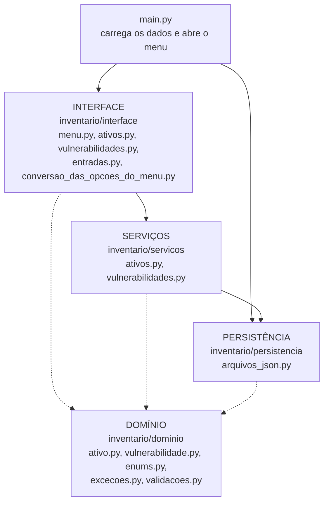

# Gerenciador de Ativos e Vulnerabilidades de TI

*[Read in English](../README.md)*

Aplicação CLI em Python para cadastro e gestão de ativos de TI e suas vulnerabilidades, com análise de risco baseada em álgebra linear (em desenvolvimento). Projeto de estudo do curso de Cibersegurança da UFU, com foco em boas práticas de código: nomenclatura clara, funções com responsabilidade única, arquitetura em camadas, programação orientada a objetos e tratamento de erros sem exposição de dados internos.

## ✨ Funcionalidades

### Ativos
Cada tipo de ativo é uma **subclasse própria** de `Ativo`, com atributos específicos:

- **Notebook**: sistema operacional, tamanho de tela
- **Servidor**: quantidade de RAM, armazenamento
- **Roteador**: quantidade de portas, velocidade
- **Impressora**: cor (colorida / preto e branco), tecnologia (tinta / laser)

**Operações disponíveis:**
- **Cadastro**: ID, nome, tipo, setor (TI / Financeiro / Marketing / RH / Jurídico), responsável, status (Ativo / Inativo / Em manutenção) e atributos específicos do tipo escolhido, todos com validação de entradas.
- **Listagem**: exibe todos os ativos, filtra por **tipo** ou por **status**, ou mostra um ativo buscando por **ID** ou por **nome/hostname** (busca parcial, case-insensitive).
- **Edição**: atualiza responsável, status, setor e atributos específicos, ou **troca o tipo** do ativo mantendo as vulnerabilidades vinculadas.
- **Exclusão**: remove um ativo pelo ID, com confirmação antes da exclusão.

### Vulnerabilidades
As vulnerabilidades ficam em um **catálogo** único, independente dos ativos. Cada ativo guarda apenas uma **referência** (o ID da vulnerabilidade) e o **status de tratamento** daquela vulnerabilidade nele. Assim, uma mesma vulnerabilidade pode estar aberta em um ativo e corrigida em outro, e corrigir seus dados no catálogo atualiza todos os ativos vinculados de uma vez.

- **Cadastro no catálogo**: nome e **nota CVSS** (de 0.1 a 10.0, aceitando vírgula como separador decimal e arredondada para uma casa), com ID gerado automaticamente
- **Nível de severidade**: calculado a partir da nota CVSS pelas faixas oficiais (Baixo / Médio / Alto / Crítico), então nunca contradiz a nota
- **Vínculo**: liga uma vulnerabilidade do catálogo a um ativo, com status de tratamento (Aberta / Em tratamento / Corrigida / Aceita)
- **Listagem**: exibe o catálogo inteiro, ou as vulnerabilidades de um ativo com o status de cada uma nele
- **Atualização de status**: muda o status de tratamento de uma vulnerabilidade em um ativo específico
- **Desvínculo**: tira uma vulnerabilidade de um ativo, mantendo-a no catálogo
- **Edição no catálogo**: corrige o nome ou a nota CVSS
- **Exclusão do catálogo**: remove uma vulnerabilidade do catálogo e de todos os ativos vinculados, com confirmação

> **Em desenvolvimento:** integração com o CVE para identificação de vulnerabilidades conhecidas.

### Análise de Risco (em desenvolvimento)
Modelo baseado em álgebra linear que estima o risco de cada ativo a partir de suas vulnerabilidades e das dependências entre ativos. O catálogo e os vínculos são a base da matriz de incidência `M` e do vetor de severidade `v`, usados para calcular o risco próprio de cada ativo (`b = Mv`).

### Geral
- **Persistência de dados**: os ativos e seus vínculos são salvos em `ativos.json`, e o catálogo em `vulnerabilidades.json`, ambos como lista de objetos JSON, e recarregados a cada execução
- **Índice por ID**: ativos e vulnerabilidades do catálogo são armazenados em dicionários indexados por ID, permitindo busca eficiente e em tempo constante (O(1))
- **Tratamento de erro global**: Ctrl+C e Ctrl+D em qualquer ponto do programa encerram de forma limpa, sem traceback

## 🫧 Tecnologias

- Python 3.8+
- Módulos da biblioteca padrão: `json`, `enum`
- Testes: `unittest` e `pytest`; padronização: `flake8` e `black`; integração contínua com GitHub Actions
- **Em desenvolvimento**: biblioteca de álgebra linear (a definir), Docker

## ✨ Arquitetura

O projeto é organizado em **camadas**. Cada camada é um pacote dentro de `inventario/` e tem uma única responsabilidade:



**Regra de dependência:** as setas só apontam para baixo. A interface chama os serviços, e os serviços chamam a persistência. Todas as camadas podem usar o domínio (setas tracejadas), mas o domínio não importa nenhuma outra camada.

### Responsabilidade de cada camada

- **Interface** (`inventario/interface/`): é a única camada que conversa com o usuário (`input` e `print`). Mostra os menus, pede e converte as entradas e exibe os resultados e as mensagens de erro.
  - `menu.py`: `menu_principal`, `menu_listagem` e `menu_vulnerabilidades`
  - `ativos.py`: telas de cadastro, edição e exclusão de ativos (`cadastrar_ativo`, `editar_ativo`, `excluir_ativo`, `perguntar_ativo`...)
  - `vulnerabilidades.py`: telas do catálogo e dos vínculos (`cadastrar_vulnerabilidade`, `editar_vulnerabilidade`, `vincular_a_um_ativo`, `mostrar_vulnerabilidade`...)
  - `entradas.py`: funções `pedir_*`, que leem e validam o que foi digitado
  - `conversao_das_opcoes_do_menu.py`: converte a opção numerada do menu no valor do domínio (`"1"` → `StatusDoAtivo.ATIVO`, `"1"` → `Notebook`...)
- **Serviços** (`inventario/servicos/`): concentram as operações de cadastro, busca, edição, exclusão e associação. Recebem os dados prontos por parâmetro, aplicam as regras, salvam por meio da persistência e lançam `DadoInvalidoError` quando algo está errado. Não usam `input` nem `print`.
  - `ativos.py`: `registrar_ativo_no_inventario`, `atualizar_ativo_no_inventario`, `remover_ativo_do_inventario`, `obter_ativo` e as buscas (`encontrar_ativo_por_id`, `encontrar_ativo_por_nome`, `encontrar_ativos_por_status`, `listar_ativos_por_tipo`)
  - `vulnerabilidades.py`: `registrar_vulnerabilidade_no_catalogo`, `atualizar_vulnerabilidade_no_catalogo`, `excluir_vulnerabilidade_do_catalogo`, `vincular_vulnerabilidade`, `desvincular_vulnerabilidade`, `atualizar_status_vulnerabilidade` e `proximo_id`
- **Persistência** (`inventario/persistencia/`): salva e carrega os dados. Hoje há uma implementação em arquivos JSON (`arquivos_json.py`: `salvar_dados`, `carregar_dados`, `salvar_catalogo`, `carregar_catalogo`).
- **Domínio** (`inventario/dominio/`): as entidades e as regras que valem em qualquer interface, sem depender de ninguém.
  - `ativo.py`: `Ativo` e as subclasses `Notebook`, `Servidor`, `Roteador`, `Impressora`, além do `MAPA_DE_TIPOS`
  - `vulnerabilidade.py`: `Vulnerabilidade`, com o nível calculado pela nota CVSS
  - `enums.py`: `Setor`, `StatusDoAtivo`, `StatusDaVuln`, `NivelDaVulnerabilidade`, `Cor`, `Tecnologia`
  - `excecoes.py`: `DadoInvalidoError`
  - `validacoes.py`: regras de validação (`validar_nome_responsavel`, `validar_cvss`)

### Exemplo de fluxo: excluir um ativo

```
menu_principal                      (interface)  usuário escolhe a opção 3
└── excluir_ativo                   (interface)
    ├── perguntar_ativo             (interface)  pede o ID
    │   └── obter_ativo             (serviço)    busca; lança erro se não existir
    ├── confirmar_exclusao          (interface)  pede "sim"
    └── remover_ativo_do_inventario (serviço)    apaga do inventário
        └── salvar_dados            (persistência)
```

### Decisões de projeto

- **Serviços recebem IDs, não perguntas:** todo serviço trabalha com dados prontos (ex.: `remover_ativo_do_inventario(ativos, id_ativo)`). Assim, a mesma regra pode ser usada pelo menu do terminal ou por uma API, sem depender de `input`.
- **Erros sobem, a interface mostra:** os serviços e o domínio lançam `DadoInvalidoError` com a mensagem; a interface captura e exibe essa mensagem. O texto de cada erro fica escrito em um lugar só.
- **Validação em profundidade:** regras como a faixa do CVSS (`validar_cvss`) ficam no domínio e são usadas tanto pela interface (para pedir de novo) quanto pelos serviços (como garantia, venha o dado de onde vier).
- **Uma lista de tipos só:** a lista de tipos de ativo mora no domínio (`MAPA_DE_TIPOS`); a numeração do menu (`TIPOS_DE_ATIVOS`) é gerada a partir dela pela interface.
- **Preparado para mudanças:** trocar o terminal por um serviço HTTP mexe só na camada de interface, e trocar os arquivos JSON por um banco SQL mexe só na camada de persistência.

### Modelo do domínio

- **Hierarquia de classes**: `Ativo` (base) + `Notebook`, `Servidor`, `Roteador`, `Impressora` (subclasses)
- **Polimorfismo**: cada subclasse sobrescreve `exibir_detalhes()` e adiciona seus atributos específicos
- **Catálogo de vulnerabilidades**: objetos `Vulnerabilidade` guardados no dicionário `catalogo[id]`; cada ativo mantém um dicionário de vínculos `{id_vulnerabilidade: StatusDaVuln}` (referência, não cópia)
- **Nível calculado**: `Vulnerabilidade.nivel()` obtém o nível de severidade a partir da nota CVSS
- **Serialização / desserialização**: `para_dicionario()` converte objetos em dicionários; `de_dicionario()` (método de classe) reconstrói objetos a partir de dicionários
- **Índice por ID**: dicionários `ativos[id]` e `catalogo[id]` para busca O(1)

## 🫧 Estrutura do projeto

```
.
├── main.py
├── inventario/
│   ├── interface/
│   │   ├── menu.py
│   │   ├── ativos.py
│   │   ├── vulnerabilidades.py
│   │   ├── entradas.py
│   │   └── conversao_das_opcoes_do_menu.py
│   ├── servicos/
│   │   ├── ativos.py
│   │   └── vulnerabilidades.py
│   ├── persistencia/
│   │   └── arquivos_json.py
│   └── dominio/
│       ├── ativo.py
│       ├── vulnerabilidade.py
│       ├── enums.py
│       ├── excecoes.py
│       └── validacoes.py
├── tests/
│   ├── apoio.py
│   ├── testes.py
│   ├── test_vulnerabilidades.py
│   └── test_exemplos.py
├── docs/
│   ├── README.pt-br.md
│   ├── requisitos.md
│   ├── validacoes.md
│   ├── criterios_aceitacao.md
│   ├── especificacao.md
│   ├── relatorio_testes.md
│   └── entrega_final.md
├── .github/workflows/testes.yml
├── .flake8
├── pyproject.toml
├── .gitignore
└── README.md
```

> Os arquivos de dados `ativos.json` e `vulnerabilidades.json` são gerados automaticamente na primeira execução e não são versionados.

## ✨ Como executar

Pré-requisito: Python 3.8 ou superior instalado.

```bash
git clone https://github.com/cadulugaresi/it-asset-vulnerability-manager.git
cd it-asset-vulnerability-manager
python3 main.py
```

> No Windows, use `python` no lugar de `python3`.

O programa abre um menu interativo no terminal. Basta seguir as opções numeradas para cadastrar ativos, gerenciar vulnerabilidades e salvar os dados.

### Menu principal

```
1 - Cadastrar ativo
2 - Listar ativo
3 - Excluir ativo
4 - Menu de vulnerabilidades
5 - Editar ativo
6 - Sair
```

Dentro da opção 2 (Listar ativo), é possível listar **todos**, **filtrar** por tipo ou status, ou mostrar **um** ativo buscando por nome ou ID.

Dentro da opção 4 (Menu de vulnerabilidades), um submenu gerencia o catálogo e os vínculos entre vulnerabilidades e ativos:

```
1 - Cadastrar vulnerabilidade
2 - Listar catálogo de vulnerabilidades
3 - Vincular vulnerabilidade a um ativo
4 - Listar vulnerabilidades de um ativo
5 - Atualizar status da vulnerabilidade em um ativo
6 - Desvincular vulnerabilidade de um ativo
7 - Excluir vulnerabilidade do catálogo
8 - Editar vulnerabilidade no catálogo
9 - Voltar ao menu principal
```

Dentro da opção 5 (Editar ativo), um submenu permite atualizar responsável, status, setor, atributos específicos ou o tipo de um ativo. As alterações são salvas ao escolher "Voltar".

### Rodando os testes

```bash
python3 -m unittest tests/testes.py tests/test_vulnerabilidades.py
python3 -m pytest tests/test_exemplos.py
python3 -m flake8 main.py inventario
python3 -m black --check main.py inventario
```

Os testes que salvam dados herdam de `TesteComArquivosTemporarios` (`tests/apoio.py`), que troca os arquivos JSON reais por temporários durante cada teste.

## 🫧 Política de Exclusão

O sistema adota **exclusão física**:
- Ao remover um **ativo**, o registro é apagado permanentemente do arquivo `ativos.json`, junto com seus vínculos. As vulnerabilidades em si continuam no catálogo.
- Ao remover uma **vulnerabilidade** do catálogo, ela é apagada permanentemente do arquivo `vulnerabilidades.json` e desvinculada de todos os ativos, para que nenhum ativo fique apontando para uma vulnerabilidade que não existe mais.

**Justificativa:**
- O escopo do projeto não exige auditoria ou histórico de remoções;
- Manter registros deletados aumentaria a complexidade sem benefício claro;
- O usuário deve confirmar a exclusão antes de removê-la (mitigação de remoção acidental).

**Exclusão lógica** (marcar como inativo em vez de apagar) foi considerada, mas descartada por não estar no escopo.

## ✨ Requisitos atendidos

### Trabalho 1 (Sprints 1 e 2)
- [x] Classes representam entidades do domínio
- [x] Funções com responsabilidade única
- [x] Regras de negócio separadas da entrada/saída
- [x] Persistência em JSON
- [x] Índice por ID (busca O(1))
- [x] Branches e merge no Git

## 🫧 Requisitos do Trabalho 2

| #   | Requisito                                    | Status |
| --- | -------------------------------------------- | ------ |
| 1   | Ativos como objetos individuais (subclasses) | ✅     |
| 2   | Persistência em JSON                         | ✅     |
| 3   | Arquitetura em camadas (S4_01)               | ✅     |
| 4   | Execução em container Docker                 | ⏳     |
| 5   | Cálculo de risco (álgebra linear)            | ⏳     |

## ✨ Licença

Projeto de estudo, livre para uso educacional.
