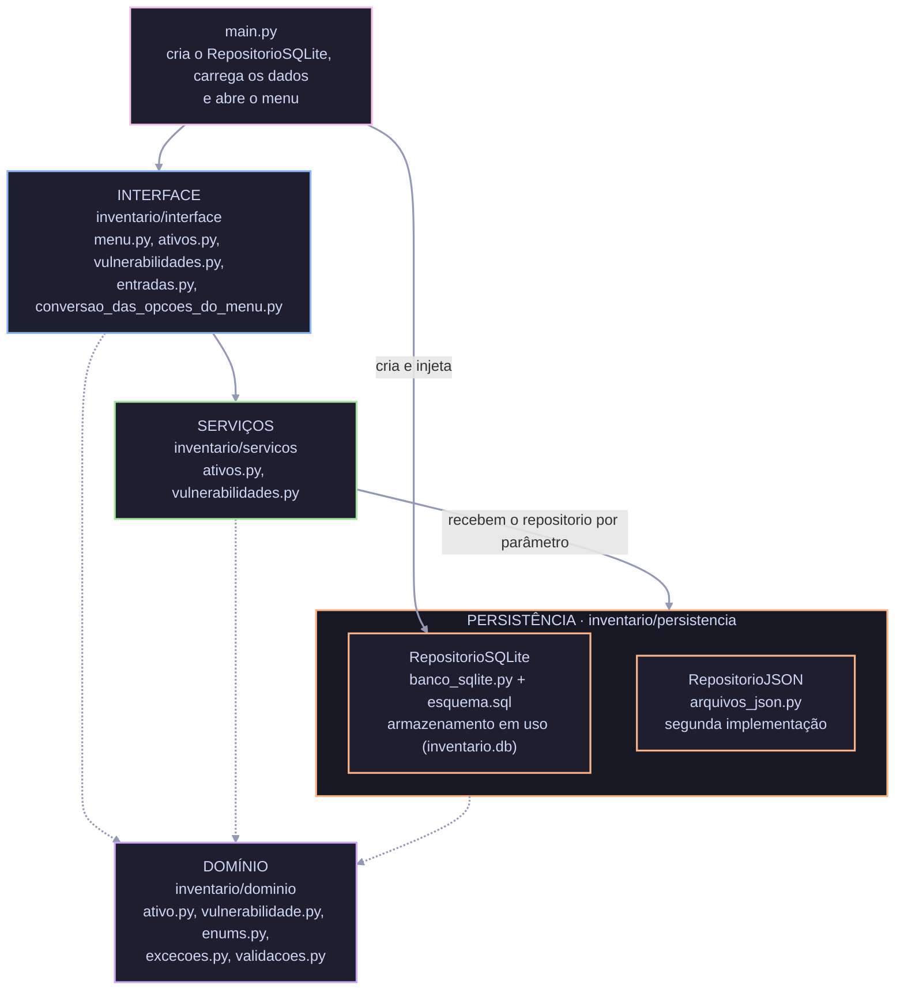

# Gerenciador de Ativos e Vulnerabilidades de TI

*[Read in English](../README.md)*

Aplicação CLI em Python para cadastro e gestão de ativos de TI e suas vulnerabilidades, com análise de risco baseada em álgebra linear. Projeto de estudo do curso de Cibersegurança da UFU, com foco em boas práticas de código: nomenclatura clara, funções com responsabilidade única, arquitetura em camadas, programação orientada a objetos e tratamento de erros sem exposição de dados internos.

## ✨ Funcionalidades

### Ativos
Cada tipo de ativo é uma **subclasse própria** de `Ativo`, com atributos específicos:

- **Notebook**: sistema operacional, tamanho de tela
- **Servidor**: quantidade de RAM, armazenamento
- **Roteador**: quantidade de portas, velocidade
- **Impressora**: cor (colorida / preto e branco), tecnologia (tinta / laser)

**Operações disponíveis:**
- **Cadastro**: ID, nome, tipo, setor (TI / Financeiro / Marketing / RH / Jurídico), responsável, status (Ativo / Inativo / Em manutenção) e atributos específicos do tipo escolhido, todos com validação de entradas.
- **Listagem**: exibe todos os ativos, filtra por **tipo** ou por **status**, ou mostra um ativo buscando por **ID** ou por **nome/hostname** (busca parcial, case-insensitive).
- **Edição**: atualiza responsável, status, setor e atributos específicos, ou **troca o tipo** do ativo mantendo as vulnerabilidades vinculadas.
- **Exclusão**: remove um ativo pelo ID, com confirmação antes da exclusão.

### Vulnerabilidades
As vulnerabilidades ficam em um **catálogo** único, independente dos ativos. Cada ativo guarda apenas uma **referência** (o ID da vulnerabilidade) e o **status de tratamento** daquela vulnerabilidade nele. Assim, uma mesma vulnerabilidade pode estar aberta em um ativo e corrigida em outro, e corrigir seus dados no catálogo atualiza todos os ativos vinculados de uma vez.

- **Cadastro no catálogo**: nome e **nota CVSS** (de 0.1 a 10.0, aceitando vírgula como separador decimal e arredondada para uma casa), com ID gerado automaticamente
- **Nível de severidade**: calculado a partir da nota CVSS pelas faixas oficiais (Baixo / Médio / Alto / Crítico), então nunca contradiz a nota
- **Vínculo**: liga uma vulnerabilidade do catálogo a um ativo, com status de tratamento (Aberta / Em tratamento / Corrigida / Aceita)
- **Listagem**: exibe o catálogo inteiro, ou as vulnerabilidades de um ativo com o status de cada uma nele
- **Atualização de status**: muda o status de tratamento de uma vulnerabilidade em um ativo específico
- **Desvínculo**: tira uma vulnerabilidade de um ativo, mantendo-a no catálogo
- **Edição no catálogo**: corrige o nome ou a nota CVSS
- **Exclusão do catálogo**: remove uma vulnerabilidade do catálogo e de todos os ativos vinculados, com confirmação

> **Em desenvolvimento:** integração com o CVE para identificação de vulnerabilidades conhecidas.

### Análise de Risco
Modelo baseado em álgebra linear que estima o risco de cada ativo a partir de suas vulnerabilidades e das dependências entre ativos. O cálculo fica em `inventario/servicos/riscos.py` e usa o `numpy`:

- **Matriz `M`** (ativos × vulnerabilidades): `1` quando a vulnerabilidade está vinculada ao ativo com status Aberta, Em tratamento ou Aceita; `0` quando está Corrigida ou não está vinculada
- **Vetor `v`**: a nota CVSS de cada vulnerabilidade do catálogo
- **Fator de exposição `f`**: um peso por ativo. Cada subclasse tem o seu padrão em `FATOR_EXPOSICAO_PADRAO` (Notebook 1.2, Servidor 1.3, Roteador 1.5, Impressora 0.9), e o valor pode ser alterado em cada ativo no cadastro e na edição, maior que 0 e no máximo 2
- **Risco próprio**: `b = f × (M @ v)`
- **Matriz `A`** (ativos × ativos): `A[i][j]` é a fração do risco que o ativo `i` herda do ativo `j`, tirada das dependências
- **Risco efetivo**: a solução de `(I − A)x = b` com `np.linalg.solve`. Antes de resolver, o programa confere se o determinante de `I − A` não é quase zero (tolerância `1e-10`); se for, mostra um erro pedindo para revisar as frações das dependências
- **Risco herdado**: risco efetivo − risco próprio
- **Ranking**: os ativos ordenados pelo risco efetivo, do maior para o menor (`AnaliseDeRisco.ranking()`)

A opção 7 do menu principal mostra uma linha por ativo, na ordem do ranking, com o fator de exposição e os riscos próprio, herdado e efetivo, seguida de uma legenda.

### Geral
- **Persistência de dados**: os ativos, o catálogo e os vínculos são salvos em um banco SQLite (`inventario.db`), com uma tabela por tipo de ativo e a tabela associativa `vinculos` entre ativos e vulnerabilidades, e recarregados a cada execução
- **Armazenamento substituível**: os serviços recebem um `repositorio` como parâmetro (injeção de dependência feita no `main.py`) e não importam a persistência; o `RepositorioSQLite` é o armazenamento em uso, e o `RepositorioJSON` (arquivos JSON) é mantido como segunda implementação, que oferece as mesmas operações, o que é garantido pela suíte de testes de contrato
- **Índice por ID**: ativos e vulnerabilidades do catálogo são armazenados em dicionários indexados por ID, permitindo busca eficiente e em tempo constante (O(1))
- **Tratamento de erro global**: Ctrl+C e Ctrl+D em qualquer ponto do programa encerram de forma limpa, sem traceback

## 🫧 Tecnologias

- Python 3.8+
- Módulos da biblioteca padrão: `sqlite3`, `abc`, `json`, `enum`
- Banco de dados: SQLite (sem servidor para instalar; esquema em `inventario/persistencia/esquema.sql`)
- Álgebra linear: `numpy` (listado no `requirements.txt`)
- Testes: `unittest` e `pytest`; padronização: `flake8` e `black`; integração contínua com GitHub Actions
- **Em desenvolvimento**: Docker

## ✨ Arquitetura

O projeto é organizado em **camadas**. Cada camada é um pacote dentro de `inventario/` e tem uma única responsabilidade:



**Regra de dependência:** as setas só apontam para baixo. A interface chama os serviços, e os serviços usam o `repositorio` que recebem como parâmetro, sem importar a persistência. Só o `main.py` sabe qual implementação é usada: ele cria o `RepositorioSQLite` e o injeta no menu, que o repassa para as telas da interface e para os serviços. As duas implementações (`RepositorioSQLite` e `RepositorioJSON`) oferecem as mesmas operações, e isso é garantido pela suíte de testes de contrato. Todas as camadas podem usar o domínio (setas tracejadas), mas o domínio não importa nenhuma outra camada.

### Responsabilidade de cada camada

- **Interface** (`inventario/interface/`): é a única camada que conversa com o usuário (`input` e `print`). Mostra os menus, pede e converte as entradas e exibe os resultados e as mensagens de erro.
  - `menu.py`: `menu_principal`, `menu_listagem` e `menu_vulnerabilidades`
  - `ativos.py`: telas de cadastro, edição e exclusão de ativos (`cadastrar_ativo`, `editar_ativo`, `excluir_ativo`, `perguntar_ativo`...)
  - `vulnerabilidades.py`: telas do catálogo e dos vínculos (`cadastrar_vulnerabilidade`, `editar_vulnerabilidade`, `vincular_a_um_ativo`, `mostrar_vulnerabilidade`...)
  - `entradas.py`: funções `pedir_*`, que leem e validam o que foi digitado
  - `conversao_das_opcoes_do_menu.py`: converte a opção numerada do menu no valor do domínio (`"1"` → `StatusDoAtivo.ATIVO`, `"1"` → `Notebook`...)
- **Serviços** (`inventario/servicos/`): concentram as operações de cadastro, busca, edição, exclusão e associação. Recebem o repositório e os dados prontos por parâmetro, aplicam as regras, salvam pelo repositório (`repositorio.adicionar_ativo`, `repositorio.vincular`...) e lançam `DadoInvalidoError` quando algo está errado. Não usam `input` nem `print`.
  - `ativos.py`: `registrar_ativo_no_inventario`, `atualizar_ativo_no_inventario`, `remover_ativo_do_inventario`, `obter_ativo` e as buscas (`encontrar_ativo_por_id`, `encontrar_ativos_por_nome`, `encontrar_ativos_por_status`, `encontrar_ativos_por_tipo`)
  - `vulnerabilidades.py`: `registrar_vulnerabilidade_no_catalogo`, `atualizar_vulnerabilidade_no_catalogo`, `excluir_vulnerabilidade_do_catalogo`, `vincular_vulnerabilidade`, `desvincular_vulnerabilidade`, `atualizar_status_vulnerabilidade` e `proximo_id`
- **Persistência** (`inventario/persistencia/`): salva e carrega os dados e traduz as falhas do armazenamento em `PersistenciaError`. As duas implementações oferecem as mesmas 14 operações, conferidas pela suíte de testes de contrato: `carregar_ativos`, `carregar_catalogo`, `adicionar_ativo`, `atualizar_ativo`, `remover_ativo`, `adicionar_vulnerabilidade`, `atualizar_vulnerabilidade`, `remover_vulnerabilidade`, `vincular`, `atualizar_status_vinculo`, `desvincular`, `adicionar_dependencia`, `remover_dependencia` e `atualizar_dependencia`.
  - `banco_sqlite.py`: `RepositorioSQLite`, o armazenamento usado pelo programa (`inventario.db`); cria as tabelas ao iniciar, liga as chaves estrangeiras e remonta cada ativo com um `JOIN` entre `ativos` e a tabela do tipo dele
  - `esquema.sql`: o esquema do banco: a tabela `ativos`, uma tabela por tipo (`notebooks`, `servidores`, `roteadores`, `impressoras`), `vulnerabilidades` e a tabela associativa `vinculos`, todas com `ON DELETE CASCADE`
  - `arquivos_json.py`: `RepositorioJSON`, a segunda implementação, que salva em `ativos.json` e `vulnerabilidades.json` com escrita atômica
- **Domínio** (`inventario/dominio/`): as entidades e as regras que valem em qualquer interface, sem depender de ninguém.
  - `ativo.py`: `Ativo` e as subclasses `Notebook`, `Servidor`, `Roteador`, `Impressora`, além do `MAPA_DE_TIPOS`
  - `vulnerabilidade.py`: `Vulnerabilidade`, com o nível calculado pela nota CVSS
  - `enums.py`: `Setor`, `StatusDoAtivo`, `StatusDaVuln`, `NivelDaVulnerabilidade`, `Cor`, `Tecnologia`
  - `excecoes.py`: `DadoInvalidoError` e `PersistenciaError`
  - `validacoes.py`: regras de validação (`validar_nome_responsavel`, `validar_cvss`)

### Exemplo de fluxo: excluir um ativo

```
menu_principal                         (interface)     usuário escolhe a opção 4
└── excluir_ativo                      (interface)
    ├── perguntar_ativo                (interface)     pede o ID
    │   └── obter_ativo                (serviço)       busca; lança erro se não existir
    ├── confirmar_exclusao             (interface)     pede "sim"
    └── remover_ativo_do_inventario    (serviço)       apaga do inventário
        └── repositorio.remover_ativo  (persistência)  DELETE FROM ativos (ON DELETE CASCADE)
```

### Decisões de projeto

- **Serviços recebem IDs, não perguntas:** todo serviço trabalha com dados prontos (ex.: `remover_ativo_do_inventario(ativos, id_ativo)`). Assim, a mesma regra pode ser usada pelo menu do terminal ou por uma API, sem depender de `input`.
- **Erros sobem, a interface mostra:** os serviços e o domínio lançam `DadoInvalidoError` com a mensagem; a interface captura e exibe essa mensagem. O texto de cada erro fica escrito em um lugar só.
- **Validação em profundidade:** regras como a faixa do CVSS (`validar_cvss`) ficam no domínio e são usadas tanto pela interface (para pedir de novo) quanto pelos serviços (como garantia, venha o dado de onde vier).
- **Uma lista de tipos só:** a lista de tipos de ativo mora no domínio (`MAPA_DE_TIPOS`); a numeração do menu (`TIPOS_DE_ATIVOS`) é gerada a partir dela pela interface.
- **Depender da abstração:** os serviços recebem um `repositorio` por parâmetro, em vez de importar um módulo de armazenamento. Trocar os arquivos JSON pelo banco SQLite mexeu só na camada de persistência e no repositório criado no `main.py`.
- **Cada operação salva só o que mudou:** em vez de regravar tudo, cada serviço chama a operação correspondente do repositório (`adicionar_ativo`, `desvincular`...), que vira um único `INSERT`, `UPDATE` ou `DELETE` no banco.
- **Preparado para mudanças:** trocar o terminal por um serviço HTTP mexe só na camada de interface.

### Modelo do domínio

- **Hierarquia de classes**: `Ativo` (base) + `Notebook`, `Servidor`, `Roteador`, `Impressora` (subclasses)
- **Polimorfismo**: cada subclasse sobrescreve `exibir_detalhes()` e adiciona seus atributos específicos
- **Catálogo de vulnerabilidades**: objetos `Vulnerabilidade` guardados no dicionário `catalogo[id]`; cada ativo mantém um dicionário de vínculos `{id_vulnerabilidade: StatusDaVuln}` (referência, não cópia)
- **Nível calculado**: `Vulnerabilidade.nivel()` obtém o nível de severidade a partir da nota CVSS
- **Serialização / desserialização**: `para_dicionario()` converte objetos em dicionários; `de_dicionario()` (método de classe) reconstrói objetos a partir de dicionários
- **Índice por ID**: dicionários `ativos[id]` e `catalogo[id]` para busca O(1)

## 🫧 Estrutura do projeto

```
.
├── main.py
├── inventario/
│   ├── interface/
│   │   ├── menu.py
│   │   ├── ativos.py
│   │   ├── vulnerabilidades.py
│   │   ├── entradas.py
│   │   └── conversao_das_opcoes_do_menu.py
│   ├── servicos/
│   │   ├── ativos.py
│   │   └── vulnerabilidades.py
│   ├── persistencia/
│   │   ├── banco_sqlite.py
│   │   ├── esquema.sql
│   │   └── arquivos_json.py
│   └── dominio/
│       ├── ativo.py
│       ├── vulnerabilidade.py
│       ├── enums.py
│       ├── excecoes.py
│       └── validacoes.py
├── tests/
│   ├── apoio.py
│   ├── contrato_repositorio.py
│   ├── test_repositorio.py
│   ├── test_repositorio_sqlite.py
│   ├── test_persistencia.py
│   ├── testes.py
│   ├── test_vulnerabilidades.py
│   └── test_exemplos.py
├── docs/
│   ├── README.pt-br.md
│   ├── requisitos.md
│   ├── validacoes.md
│   ├── criterios_aceitacao.md
│   ├── especificacao.md
│   ├── relatorio_testes.md
│   ├── entrega_final.md
│   ├── solid.md
│   └── exemplos/
│       ├── exemplo_ativos.json
│       └── exemplo_vulnerabilidades.json
├── .github/workflows/testes.yml
├── .flake8
├── pyproject.toml
├── .gitignore
└── README.md
```

> O banco `inventario.db` é criado automaticamente na primeira execução, com as tabelas do `esquema.sql`, e não é versionado. Os arquivos JSON usados pelo `RepositorioJSON` também não são versionados; `docs/exemplos/` tem arquivos de exemplo no mesmo formato.
>
> `docs/solid.md` é o relatório SOLID (S4_02), e as [consultas SQL](https://github.com/cadulugaresi/ciberseguranca-ufu-t2/tree/main/Sprint%204/s4_07) (no repositório de exercícios) trazem consultas comentadas com `INNER JOIN` e `LEFT JOIN` sobre o banco (S4_06), além de consultas de agregação com `COUNT`, `SUM`, `GROUP BY`, `HAVING` e `CASE` (S4_07).

## ✨ Como executar

Pré-requisito: Python 3.8 ou superior instalado. A única dependência externa é o `numpy`, listado no `requirements.txt`.

```bash
git clone https://github.com/cadulugaresi/it-asset-vulnerability-manager.git
cd it-asset-vulnerability-manager
python3 -m pip install -r requirements.txt
python3 main.py
```

> No Windows, use `python` no lugar de `python3`.

O programa abre um menu interativo no terminal. Basta seguir as opções numeradas para cadastrar ativos, gerenciar vulnerabilidades e salvar os dados.

### Menu principal

```
1 - Cadastrar ativo
2 - Listar ativos
3 - Editar ativo
4 - Excluir ativo
5 - Menu de vulnerabilidades
6 - Menu de dependências
7 - Análise de risco
8 - Sair
```

Dentro da opção 2 (Listar ativos), é possível listar **todos**, **filtrar** por tipo ou status, ou mostrar **um** ativo buscando por nome ou ID.

Dentro da opção 3 (Editar ativo), um submenu permite atualizar responsável, status, setor, atributos específicos ou o tipo de um ativo. As alterações são salvas ao escolher "Voltar".

Dentro da opção 5 (Menu de vulnerabilidades), um submenu gerencia o catálogo e os vínculos entre vulnerabilidades e ativos:

```
1 - Cadastrar vulnerabilidade
2 - Listar catálogo de vulnerabilidades
3 - Editar vulnerabilidade no catálogo
4 - Excluir vulnerabilidade do catálogo
5 - Vincular vulnerabilidade a um ativo
6 - Listar vulnerabilidades de um ativo
7 - Atualizar status da vulnerabilidade em um ativo
8 - Desvincular vulnerabilidade de um ativo
9 - Voltar ao menu principal
```

### Rodando os testes

```bash
python3 -m unittest tests/testes.py tests/test_vulnerabilidades.py tests/test_persistencia.py tests/test_repositorio.py tests/test_repositorio_sqlite.py
python3 -m pytest tests/test_exemplos.py
python3 -m flake8 main.py inventario
python3 -m black --check main.py inventario
```

**Suíte de contrato do repositório:** `tests/contrato_repositorio.py` define o `ContratoDoRepositorio`, um conjunto de 24 testes que descreve o que todo repositório precisa fazer: gravar e recarregar ativos, catálogo, vínculos e dependências entre ativos; atualizá-los, inclusive trocando o tipo de um ativo; e removê-los, tirando de todos os ativos uma vulnerabilidade removida. A mesma suíte roda nas duas implementações:
- `tests/test_repositorio.py`: `TestRepositorioJSON`, com arquivos JSON temporários
- `tests/test_repositorio_sqlite.py`: `TestRepositorioSQLite`, com um banco temporário, e mais um teste que confere que um banco corrompido lança `PersistenciaError`

Os testes que salvam dados nunca mexem nos arquivos reais: os de JSON herdam de `TesteComArquivosTemporarios` (`tests/apoio.py`), e os de SQLite usam um banco temporário, apagado depois de cada teste.

## 🫧 Política de Exclusão

O sistema adota **exclusão física**:
- Ao remover um **ativo**, sua linha é apagada permanentemente da tabela `ativos`. As chaves estrangeiras com `ON DELETE CASCADE` apagam junto a linha dele na tabela do tipo e os vínculos dele em `vinculos`. As vulnerabilidades em si continuam no catálogo.
- Ao remover uma **vulnerabilidade** do catálogo, sua linha é apagada permanentemente da tabela `vulnerabilidades`, e o `ON DELETE CASCADE` apaga os vínculos dela em `vinculos`, para que nenhum ativo fique apontando para uma vulnerabilidade que não existe mais.

O `RepositorioJSON` segue a mesma política, removendo os vínculos manualmente.

**Justificativa:**
- O escopo do projeto não exige auditoria ou histórico de remoções;
- Manter registros deletados aumentaria a complexidade sem benefício claro;
- O usuário deve confirmar a exclusão antes de removê-la (mitigação de remoção acidental).

**Exclusão lógica** (marcar como inativo em vez de apagar) foi considerada, mas descartada por não estar no escopo.

## ✨ Requisitos atendidos

### Trabalho 1 (Sprints 1 e 2)
- [x] Classes representam entidades do domínio
- [x] Funções com responsabilidade única
- [x] Regras de negócio separadas da entrada/saída
- [x] Persistência em JSON
- [x] Índice por ID (busca O(1))
- [x] Branches e merge no Git

## 🫧 Requisitos do Trabalho 2

| #   | Requisito                                    | Status |
| --- | -------------------------------------------- | ------ |
| 1   | Ativos como objetos individuais (subclasses) | ✅     |
| 2   | Persistência em banco SQL (SQLite)           | ✅     |
| 3   | Arquitetura em camadas (S4_01)               | ✅     |
| 4   | Execução em container Docker                 | ⏳     |
| 5   | Cálculo de risco (álgebra linear)            | ✅     |

> O requisito 2 era originalmente persistência em JSON; a persistência em banco SQLite foi confirmada pelo professor como válida.

## ✨ Licença

Projeto de estudo, livre para uso educacional.
